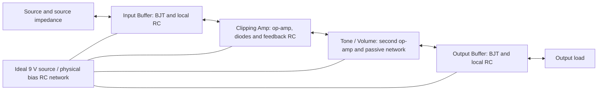
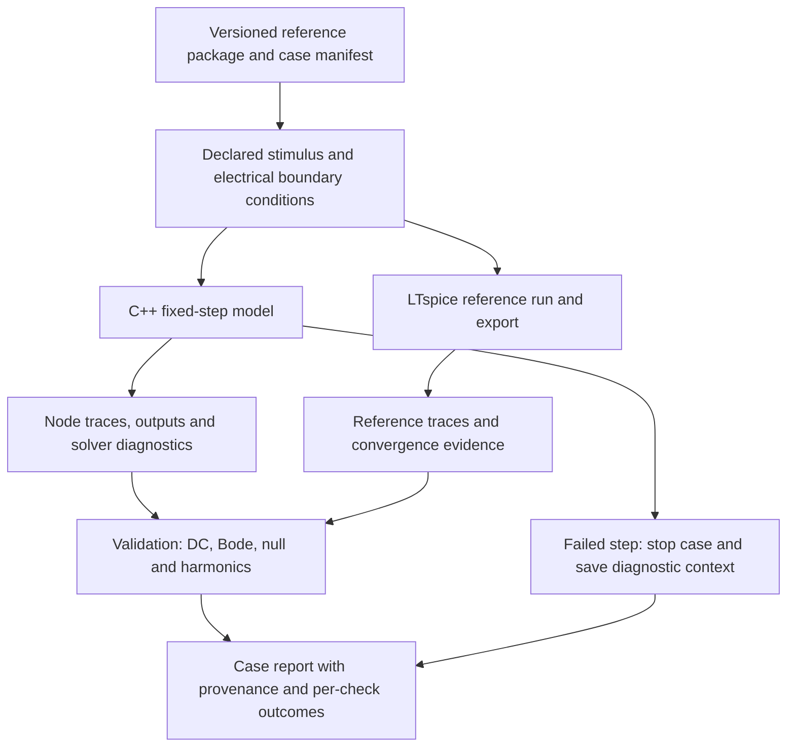

# TS808 MVP: architecture decision log

* **Author:** Project owner and Codex
* **Date:** 2026-10-31
* **Status:** T1–T20 accepted; historical proposals and alternatives preserved. Later accepted decisions supersede earlier pending statements. T20-A selects shifted-tanh outer knees with C2 joins and the shared nominal parameter package, within approved T19 revised B.

This log preserves the detailed discussions and derivative-test requirements. The current consolidated architecture is in [design_draft.md](../../design_draft.md). An accepted option does not accept every parameter or proposal recorded before it.

The owner approved the consolidated Technical Plan on 2026-10-31, including the explicitly proposed initial LTspice maxstep bound h/8. Historical references below to that fraction awaiting approval are superseded. Exact implementation contracts remain open in the current draft.

### Decision T1: Circuit solver formulation

The formulation must preserve simultaneous electrical loading and the requested diode, BJT and op-amp dynamics. These are alternative ways to express the same circuit, not three plugin implementations. Integration, tolerances and recovery are subsequent decisions; selecting a formulation does not select those details.

| Option | Mechanism and component boundary | Trade-off | Conditions that defeat the approach |
| --- | --- | --- | --- |
| A. Topology-specific modified nodal analysis (MNA), implicit nonlinear solve | Assemble coupled node/current equations for the fixed TS808; include capacitor and op-amp states and solve each implicit step with Newton. | Direct correspondence to the reference circuit and named-node diagnostics; larger coupled system and nonlinear iteration cost. | It cannot progress to real time if bounded solving fails the accuracy, convergence or CPU gates after measured optimization. Ill-conditioned equations need scaling and appropriate linear algebra. |
| B. Reduced nonlinear state space with an implicit solve | Eliminate linear algebraic variables for the fixed circuit, retain dynamic states and solve the remaining coupled nonlinear device relationships. | Potentially smaller solve; requires careful derivation and reconstruction of node values and correct treatment of model/control changes. | A reduction is unsuitable if it loses loading/dynamics, becomes ill-conditioned, or requires expensive matrix updates that defeat runtime targets. Nonlinear iteration remains necessary. |
| C. Wave digital filters with coupled nonlinear/active ports | Express connected components through incident/reflected waves and scattering relations; retain a simultaneous solution where nonlinear devices and active feedback require it. | Reusable component structures and passive-network properties; active multiports, BJTs and op-amp states require additional derivation and validation. | An implementation is unsuitable if it assumes delay-free coupled ports can be solved independently, or inserts delays/approximations that fail reference tests. Passivity of passive adaptors does not guarantee stability of the complete active circuit. |

All options require comparison with the same LTspice reference. None guarantees accuracy or a runtime budget without measurement. The paper comparison in the [RFC](./tube_screamer_rfc.md) motivated MNA as a starting proposal; the owner subsequently selected option A in this draft. Related WDF work includes the [Tube Screamer tone/volume stage](https://www.dafx.de/paper-archive/2015/DAFx-15_submission_53.pdf), which is not evidence that the complete requested circuit meets the budget.

**Decision record:** T1 accepted on 2026-10-31: topology-specific implicit MNA with Newton–Raphson, partitioned into Input Buffer, Clipping Amp, Tone/Volume and Output Buffer. This establishes the initial MVP implementation path. Replacing that path later requires documenting the failed gate, the alternative and the validation implications. The owner intends to localize nonlinear evaluation and minimize solve cost; neither exact LTspice agreement nor a CPU result follows automatically from this choice.

### Four-stage component boundaries



Arrows show electrical interaction, not independent sequential audio calls. Assign each physical component, coupling capacitor and stored charge to exactly one owner. Shared node voltages and port currents form the interconnection contract. At each internal step, joined ports share a voltage and their signed currents sum to zero. Source/load impedances remain explicit. If Vref has finite impedance, its shared behavior couples stages beyond the three signal boundaries; it cannot be replaced by four independent ideal references without changing the circuit.

Nonlinear residual/Jacobian evaluation is local to devices and their blocks. The buffers contain nonlinear BJTs; the clipping block contains nonlinear diode and op-amp behavior. The second op-amp in Tone/Volume also needs the requested slew/saturation model. Its nonlinear terms may be inactive in a particular test but cannot be omitted on that assumption. Linear passive terms can be assembled separately and reused when timestep and parameters allow; the linear solve still updates as nonlinear Jacobian terms change.

MNA preserves correspondence between schematic nodes/components and equations. Numerical agreement with LTspice additionally depends on matching device equations, integration, tolerances, source/load and initial conditions. A partition that is algebraically equivalent to the assembled discrete system still has time-discretization error against a converged continuous-time reference. Runtime savings depend on actual matrix sizes, sparsity, conditioning and iteration counts.

### Decision T2: Coupling the partitioned blocks

Both choices below retain electrical coupling at the current timestep. Neither introduces a sample delay or replaces a dynamic neighboring block by a fixed scalar impedance. Both must test the full circuit residual and port-current balance, commit dynamic states only after complete convergence, and report failed solves. The exact port map follows the frozen schematic.

| Option | Mechanism | Trade-off | Failure condition |
| --- | --- | --- | --- |
| A. Coupled Newton with block elimination | Each block supplies its residual and Jacobian. At each Newton iteration, eliminate internal block increments by linear solves, solve the resulting Schur-complement system for boundary/shared-node increments, then back-substitute. | Local device code and smaller internal factorizations while preserving the coupled Newton step in exact arithmetic; requires a coordinator and well-conditioned elimination. It is not four independent Newton solves. | Singular or poorly conditioned internal elimination, or excessive boundary-system cost. Requires suitable pivoting/partition treatment and full residual checks rather than assuming every natural block is independently invertible. |
| B. Local Newton solves with iterative port exchange | Solve each block for trial boundary conditions; exchange boundary voltage/current information and iterate interfaces within the same timestep until the entire circuit residual and continuity tests pass. | More independent block solvers and stage-level tests; needs both inner and outer convergence controls, and consistent state/history during all trial solves. | Strong coupling or shared bias can cause slow/stalled/divergent interface iterations even when local Newton converges. A fixed number of sweeps is an approximation unless the full residual actually passes. |

The Schur complement is only an algebraic solution strategy for the selected MNA system; it does not change T1 into the rejected alternative formulation. An equivalent full-system linear solve can be used as an offline diagnostic for the partitioned solution, without implementing a second physical model.

**Decision record:** T2 accepted on 2026-10-31: option A, coupled Newton with block elimination and a Schur-complement interface solve. Local device evaluation is retained; independent stage-by-stage Newton with iterative port exchange is not the selected path. Integration scheme, finite tolerances, iteration limits and offline/live failure policies remain open subsequent decisions.

### Coupled Newton step and state ownership

Let y collect internal block unknowns and b the retained boundary/shared unknowns. Choose retained nodes so that the internal Jacobian A is block diagonal when the actual schematic permits it. Any cross-block component or shared bias connection must appear explicitly; the four visual stages alone do not establish block diagonality. At a Newton iterate, write the scaled linearized system as:

```text
A dy + B db = -r_internal
C dy + D db = -r_boundary

S = D - C solve(A, B)
S db = -r_boundary + C solve(A, r_internal)
dy = solve(A, -r_internal - B db)
```

Here solve(A, ...) uses reusable factorizations within that iteration, not an explicit matrix inverse. The S solve is a linear boundary solve, not another nonlinear Newton loop. Reuse across Newton iterations or timesteps requires checking which coefficients actually changed. Retain pivoting/conditioning diagnostics and verify the reconstructed full-system linear residual. If an internal block is singular, no mathematical right to eliminate it exists: the partition/pivot strategy must be corrected; regularization must not silently alter the physical circuit.

For each internal timestep:

1. Read the last committed capacitor/device/op-amp history, stimulus and controls; hold that history fixed during all Newton trials for this step.
2. Evaluate each block's residual/Jacobian and assemble boundary current balances, including shared reference-network unknowns if modeled.
3. Factor internal blocks, form/solve S, and recover every internal increment.
4. Apply any damping/line search consistently to the complete increment, then evaluate the full nonlinear residual and scaled increment. Their exact acceptance rules and bounded work remain to be selected.
5. Commit the entire circuit state and output only on global convergence. A failed step leaves the previous committed history intact and is reported. Under approved T5, the offline case stops on failure.

An offline full assembled-Jacobian solve may check the same Newton iterate against the block-eliminated result to detect indexing/sign/partition errors. This checks algebraic equivalence of the two linear solution paths, not equality with LTspice. No numerical or timing evidence has been produced yet.

### Decision T3: Time integration for the offline MVP

Use the charge-based circuit form d q(x)/dt + f(x,u) = 0, including algebraic rows with no charge term. The following equations use constant timestep h and f_n = f(x_n,u_n). They are integration choices within the approved MNA/Newton formulation, not different circuit models. Any later variable-step scheme needs its own coefficients and history rules.

| Option | Discrete residual to solve with Newton | Trade-off | Failure condition |
| --- | --- | --- | --- |
| A. Backward Euler | q_n - q_(n-1) + h f_n = 0 | One history state and strong damping of unresolved fast modes; first-order accuracy can require a smaller timestep. | Numerical damping can alter audio magnitude, phase or transients enough to fail the reference gates at affordable internal rates. Stability alone is not accuracy. |
| B. Trapezoidal | q_n - q_(n-1) + (h/2)(f_n + f_(n-1)) = 0 | Second-order accuracy for sufficiently smooth solutions and low numerical damping; retains previous-step f as well as charge. | Stiff modes and abrupt changes can produce alternating timestep artifacts (trap ringing). Nonlinear limiting may reduce the expected convergence order. |
| C. BDF2 at fixed timestep | (3/2)q_n - 2q_(n-1) + (1/2)q_(n-2) + h f_n = 0 | Second-order accuracy for smooth solutions, with damping of unresolved fast modes; requires two history states and an explicit startup/restart rule. | Damping and startup effects can still fail the reference gates. Changing h without the correct variable-step coefficients invalidates this formula. |

For every option, temporal error must be tested by reducing h while keeping the stimulus definition fixed and the nonlinear/linear tolerances tighter than the error being measured. A fixed-rate model need not use LTspice's adaptive integration algorithm to approximate the same circuit, and choosing a method with the same name does not guarantee a null.

Record the exact LTspice version, integration setting, waveform compression/export settings and resampling procedure in the reference manifest. Distinguish ordinary trapezoidal integration from LTspice's modified-trap waveform post-processing. The manufacturer describes that distinction in [SPICE Differentiation](https://www.analog.com/media/en/technical-documentation/lt-journal-article/ltjournal-v24n4-01-df-spicedifferentiation-mikeengelhardt.pdf) and its [verified support answer](https://ez.analog.com/design-tools-and-calculators/ltspice/f/q-a/571510/how-to-use-modified-trap-by-setting-a-option-for-it). Reference convergence, rather than a matching method label, establishes whether the exported signal is accurate enough.

**Decision record:** T3 accepted on 2026-10-31: option B, trapezoidal integration. No silent substitution of backward Euler or BDF2 on difficult samples. Startup, recovery, test rates and acceptance thresholds remain to be specified explicitly. Trapezoidal ringing must be diagnosed by timestep refinement and node/state traces; waveform smoothing cannot hide a failed accuracy test.

### Trapezoidal device history and acceptance

For a linear capacitor with voltage v and current i in the same declared branch orientation, the companion equation at fixed h is:

```text
G_C = 2 C / h
i_n = G_C v_n + I_history
I_history = -G_C v_previous - i_previous
```

The history is fixed throughout the coupled Newton solve. Commit v_n and i_n once the entire step passes, never after an individual block solve or a rejected line-search trial. A capacitor crossing a visual stage boundary still has one component owner and one history, with contributions to the appropriate node rows.

For nonlinear stored charge, use the charge-based residual selected above and its derivative dq/dx in the Jacobian; replacing a bias-dependent capacitance by a fixed C would change the device model. Op-amp behavioral states use consistent trapezoidal history for their actual differential equations, including slew/saturation terms. Limits that make derivatives nonsmooth need an explicitly documented Newton treatment; neither the limiting equations nor their Jacobians have been finalized.

Under approved T7, solve the DC operating point first and initialize capacitor charges and op-amp states consistently with it. An equilibrium provides the initial derivative/history without requiring an automatic Euler startup step. Cold power-up is deferred beyond the MVP. Signal onset and overload/recovery from the settled circuit remain required test conditions; they must not be conflated with cold power-up or hidden by transient trimming.

Convergence of Newton and convergence with timestep refinement are distinct checks. A small algebraic residual at one h does not rule out temporal distortion or trap ringing. The offline report must keep both kinds of evidence separate.

### Decision T4: Supply rails and the shared reference network

All choices retain the accepted nominal 0/9 V rails, nominal 4.5 V bias and non-rail-to-rail op-amp headroom. The choice defines the reference circuit for comparison; it does not change the requirement to preserve port loading elsewhere.

| Option | Mechanism | Trade-off | Failure condition |
| --- | --- | --- | --- |
| A. Ideal 9 V source, physical bias RC network | Use a stiff 9 V supply, but retain the selected schematic's bias divider, decoupling capacitors and any supply-path components. Solve finite-impedance Vref nodes together with the signal circuit. | Preserves bias loading and charge dynamics without adding a battery/adapter model. Adds shared unknowns and may couple the four stages. | Does not represent source sag/ripple beyond explicitly retained circuit elements; fails a hardware claim if those omitted source effects matter. |
| B. Ideal 9 V source and ideal 4.5 V reference | Replace the bias generator by an independent stiff Vref source in both C++ and LTspice. | Smaller system and simpler stage coupling; deliberately changes the physical bias network. | Cannot validate the original bias-network loading or startup dynamics; may change audio behavior when those interactions are significant. |
| C. Finite-impedance supply source and physical bias RC network | Retain the bias network and add a documented battery/adapter source impedance and any selected ripple/dynamic behavior. | Includes source-induced interactions; needs additional parameters, reference conditions and tests. | Without a specified source model, comparisons become ambiguous; extra source states/model error can obscure the initial audio-circuit validation. |

**Decision record:** T4 accepted on 2026-10-31: option A, ideal 9 V source and the physical bias RC network from the selected schematic. Source sag/ripple modeling is outside this MVP baseline; retain actual supply-path components present in the reference circuit. No divider value or capacitor value is invented here; exact values come from the frozen reference package. Noise, temperature variation and electronic switching are separate scope questions.

### Shared bias ownership under T4

The reference package must distinguish circuit ground, the ideal supply terminal, local filtered supply nodes and bias/reference nodes. Nominal Vref is 4.5 V, but its actual DC value and transient voltage are solved from the physical network and connected loads, not clamped to that number.

The bias network is shared electrical infrastructure, not a fifth independent audio stage. Its boundary voltages are retained in the coupled system and its component stamps/history have one owner. Where convenient for elimination, internal supply/bias unknowns may be assigned their own algebraic group; this does not turn the four audio blocks into isolated circuits. Connecting the same reference label in multiple blocks means a common electrical node unless the frozen schematic explicitly separates it through components.

Offline reports must include bias-node DC values and transient traces alongside the signal nodes. Charge initial conditions and the distinction between settled-pedal and power-up tests also apply to supply/bias capacitors. A failed shared-bias solve invalidates the whole step.

### Decision T5: Offline response to a failed timestep

This decision concerns failure of the coupled Newton solve or an internal linear factorization, not the separate accuracy/convergence study that reruns complete tests at finer fixed rates. Both options retain trapezoidal integration, transactional state updates and explicit failure diagnostics. Neither permits substituting a waveshaper, accepting a large residual, or counting a concealed dropout as an accurate result.

| Option | Mechanism | Trade-off | Failure condition / result semantics |
| --- | --- | --- | --- |
| A. Fixed-step run, stop on failure | After bounded Newton/line-search work is exhausted, leave the prior committed state unchanged, stop the case and save the failing time, input, residual and iteration diagnostics. Retry only as a separately identified whole-case run with explicitly changed settings. | Straightforward sample-grid comparison, predictable work and a clear link to later fixed-rate processing; difficult cases may stop before producing a full waveform. | Incomplete cases are failed or not evaluated, never passed. This policy diagnoses convergence failure but does not make the model converge. |
| B. Bounded timestep subdivision | Roll back the failed interval and attempt a finite number of smaller trapezoidal steps. Rebuild timestep-dependent terms/history, evaluate the declared stimulus at substep times, and commit the interval only if every required substep succeeds. | Can finish some difficult offline cases; extra work, input reconstruction and nonuniform history complicate reproducibility and later runtime qualification. | Exhausted subdivision still fails the case. A recovered run is labeled as using subdivisions; it cannot prove that the target fixed-rate path converges or meets runtime limits. |

With subdivision, the capacitor companion history cannot simply be reused with its old conductance: reconstruct it from the last accepted voltage/current and the new h. Trial substeps require interval-level rollback if the full interval is rejected. Startup, source discontinuities and trapezoidal ringing require separate tests even if subdivision recovers Newton convergence.

**Decision record:** T5 accepted on 2026-10-31: option A, fixed-step execution with immediate case termination after bounded solving fails. No timestep subdivision, accepted unconverged steps or concealed waveform repair. Exact iteration/line-search caps and tolerances will be defined as part of the numerical contract. The later live plugin's audible recovery policy is separate from an offline validation run.

### Offline run and evidence flow



The two execution paths share the declared circuit/stimulus contract, not previously computed C++ output. Record input source definitions and their evaluation/interpolation rules so an adaptive LTspice time grid and a fixed C++ grid see the intended same stimulus. LTspice exports require units, node names, time coordinates and enough precision for the error budget. Specific formats and runner interfaces remain to be selected.

A completed waveform is necessary but insufficient for acceptance. A solver failure makes that case fail; partial output is retained only for diagnosis and never used as a complete passing null/THD result. Checks that cannot run on the partial data are marked not evaluated with a reason. Cases with missing, incompatible or unconverged reference data cannot pass. Stale reports are distinguished by immutable run identifiers and input/model hashes; exact schema and hash mechanism will be specified in the implementation plan.

Diagnostics include failed step/time, block/device context where known, last valid state, trial-state residual and step norms, factorization status and solver work counts. The runner must distinguish nonconvergence, nonfinite device evaluation and singular/ill-conditioned linear algebra rather than collapsing them into a generic sound difference. A rerun at a finer fixed h has a new manifest and result; it cannot overwrite the evidence that the original rate failed.

### Decision T6: What the LTspice op-amp reference represents

The accepted JRC4558 scope is an external-behavior nonideal macromodel, applied to both amplifier channels. The selected reference must define finite gain/bandwidth, slew rate, impedances, headroom and overload recovery. Nominal SR/GBW alone do not specify that model. Exact 9 V behavior and model provenance remain to be established; no particular downloadable vendor model has been obtained or validated.

| Option | Mechanism | Trade-off | Failure condition / claim limit |
| --- | --- | --- | --- |
| A. Common documented behavioral specification | Define one explicit physical behavioral specification and parameter set; implement it independently in C++ device equations and an LTspice behavioral subcircuit. Compare standalone op-amp tests before the full pedal. | Makes solver/discretization discrepancies identifiable without conflating two different op-amp models. External data must still support model parameters and limitations. | A passing null establishes numerical agreement, not that an incomplete shared specification is physically faithful. Matching errors or omitted effects can occur in both implementations; independent characterization evidence is needed before a physical-fidelity claim. |
| B. Separately sourced SPICE macromodel as the primary target | Freeze a documented third-party/manufacturer SPICE macromodel compatible with LTspice and calibrate the compact C++ behavioral model against its external behavior. | Gives an external model target; requires model availability, rights, 9 V applicability and a finite fitting/validation envelope. More target dynamics may exceed the compact model's capabilities. | Large residuals may be model mismatch rather than solver error. Vendor provenance alone does not guarantee physical accuracy; unsupported supply conditions or unmodeled recovery can make the proposed C++ model unable to pass. |

Both options require standalone checks for operating point, small-signal/open- and closed-loop response, slew, input/output loading, headroom and overload recovery under declared conditions. Both retain datasheet/characterization evidence distinct from circuit null results. The [manufacturer product page](https://www.nisshinbo-microdevices.co.jp/en/products/operational-amplifier/spec/?product=njm4558) is a source for device information, not proof that a selected model matches a historical unit at 9 V.

**Decision record:** T6 accepted on 2026-10-31: option A, a common documented physical behavioral specification implemented independently in C++ and an LTspice behavioral subcircuit. Numerical agreement and external physical characterization are separate evidence requirements. This does not choose diode/BJT equations or their model parameters; those must also match the frozen reference rather than arbitrary generic device names.

### Behavioral specification and independent checks

The specification is the authoritative definition of equations, units, sign conventions, states and parameters, not either executable implementation. Both op-amp channels use the same model definition with separately owned dynamic states and electrical pins. C++ output must not be used to generate the LTspice expected waveform.

The model definition must explicitly describe finite open-loop DC gain, pole/state dynamics consistent with the gain-bandwidth target, slew behavior, differential/common-mode input impedances where included, output impedance, positive/negative headroom and saturation recovery. Whether offset, bias currents and output current limiting are modeled or excluded must be declared. Do not assume a particular slew limiter, saturation smoothing law or recovery time solely from the nominal SR/GBW values. Exact laws and parameters remain open design work.

Standalone tests apply the same circuits and stimuli to each implementation before the pedal comparison: DC transfer/bias, small-signal gain and phase, slew-limited steps, output loading, headroom and overload/recovery. Tests must include the declared 9 V supply and relevant operating-point/input ranges. A shared specification can be physically incomplete even when both implementations agree; maintain a table linking each effect/parameter to manufacturer data, other characterization evidence or an explicitly unverified assumption. Unsupported assumptions limit physical claims and cannot disappear into a passing solver report.

Keep reference versions and hashes for both implementations and the specification. A model change invalidates results tied to the old model identity. Numerical tolerances, interpolation and exported precision belong to the comparison configuration rather than being fitted implicitly to each waveform.

### Decision T7: Initialization and power-up test scope

The baseline audio comparison must distinguish a settled pedal from a pedal whose capacitors are charging. Both choices below include a DC operating-point solve for the loaded circuit at the declared constant pre-stimulus input. Initialize capacitor charge and op-amp states from that equilibrium, verify the DC residual, and use consistent trapezoidal history. Do not replace the finite-impedance bias network with a clamped Vref during initialization.

| Option | Mechanism | Trade-off | Failure condition / claim limit |
| --- | --- | --- | --- |
| A. Settled-pedal initialization for the MVP | All required MVP audio tests begin from a verified loaded DC equilibrium. Cold power-up validation is deferred and listed as untested. Include signal onset, clipping and overload recovery from that equilibrium. | Smaller validation scope and a clear basis for null/Bode/THD comparisons; does not validate turn-on behavior. | A failed DC solve invalidates the case. Passing audio tests cannot support claims about power-up, uncharged capacitors or time required for Vref to settle. |
| B. Settled-pedal baseline plus explicit cold-start suite | Retain the same baseline and add separately identified power-up tests with declared charge/state initial conditions and an ideal source ramp from 0 to 9 V. Match the source trajectory and initial conditions in both implementations. | Validates additional bias/coupling-capacitor dynamics; requires non-equilibrium trapezoidal history initialization and behavior of the op-amp model during the supply ramp. | Undefined low-supply macromodel behavior, incompatible initial constraints or missing initial derivative rules invalidate the cold-start claim. These cases must not be mixed with settled audio null tests. |

In either choice, initial input, control positions, load and equilibrium values belong in the manifest. No arbitrary transient trimming may conceal initialization error. Any warm-up interval and the analysis window must be declared before a run. Multiple DC solutions, if encountered, require a documented operating-branch selection rather than choosing the branch that yields the smallest audio residual. DC solving details and startup convergence aids will be specified explicitly; no production implementation is implied here.

**Decision record:** T7 accepted on 2026-10-31: option A, settled-pedal initialization from a verified loaded DC operating point. Cold power-up is outside the MVP validation claim. Signal onset, clipping and overload/recovery from the settled circuit remain in scope. Retain trapezoidal integration and stop-on-failure; no automatic Euler startup or adaptive stepping.

### Settled operating-point contract

Solve the entire loaded DC circuit with the chosen controls, source DC level and ideal 9 V supply. Capacitor DC branch currents are zero; capacitor charge follows the solved terminal voltages and the selected charge law. Op-amp internal states must satisfy their steady-state equations rather than arbitrary zero assignments. Store the full solved state and residual diagnostics with the case.

At a constant equilibrium, initialize trapezoidal history with zero charge derivative. For a linear capacitor this means its previous current is zero and its voltage equals the solved operating-point voltage. The first driven step uses the actual declared previous input/state and the new input; it does not implicitly charge every capacitor from zero. Verify an unchanged-input hold test before using that state for driven comparisons. A held equilibrium that drifts beyond the numerical budget is a failed initialization/model test.

If the DC solve fails, no audio comparison starts. The report distinguishes DC failure from transient failure. DC convergence aids, if included later, must be recorded and must finish at the original unmodified circuit equations; their algorithm and work limits remain part of the pending solver contract.

### Decision T8: Initial numerical acceptance contract

The following initial contract is approved for the stock TS808 offline MVP. These values carry forward the RFC's discussion targets; they are project acceptance choices, not manufacturer specifications, achieved measurements or a guarantee of audibility. They apply only to a finite, versioned test matrix with declared circuit, input levels, controls, loads and analysis windows. That matrix and the exact device parameters still need to be frozen before implementation readiness.

Let e[n] = v_cpp[n] - v_reference[n], after unit conversion and declared sample-time alignment. For nonsilent cases report 20 log10(RMS(e)/RMS(reference)) and 20 log10(max|e|/max|reference|). No per-case gain fitting, EQ or time warping is allowed. Model input/output are expressed in volts for circuit-only tests; dBFS calibration belongs to later audio-file/end-to-end interfaces.

| Required check | Approved initial gate | Required evidence / exceptions |
| --- | --- | --- |
| Loaded DC operating point | Absolute voltage error at each declared key node ≤10 mV. | Include Vref, buffer bias and op-amp nodes; this is not the Newton residual tolerance. More sensitive nodes may need tighter limits once the circuit is frozen. |
| Small-signal Bode response | Magnitude error ≤0.2 dB and phase error ≤2 degrees over 20 Hz–20 kHz. | Verify linear scaling of the excitation, unwrap phase consistently and declare the frequency grid. Bins near a transfer zero need a predefined absolute-complex-error rule, not discretionary removal after seeing results. |
| Circuit-only steady-state null | Residual RMS ≤−60 dB relative to reference RMS and residual peak ≤−40 dB relative to reference peak. | Require both. For reference RMS <1 mV, proposed absolute limits are 1 uV RMS and 10 uV peak instead; report volts and normalized values where defined. |
| Startup from DC / signal onset / overload recovery | Finite converged state at every step; report waveform residual, bias recovery and time-local errors over the full declared interval. | These are required cases but final amplitude/recovery-time limits remain open until the stimulus envelope and macromodel are specified. They cannot be counted as accepted solely from a steady-state null. |
| Harmonic spectra and THD | Each selected harmonic above −80 dBc is within 1 dB of the reference; THD relative error ≤5% where above the declared measurement floor. | Use coherent tones or a fully specified estimator, the same bandwidth/harmonic set, and floor rules fixed before testing. Proposed fundamentals: 82, 440, 1000 and 5000 Hz, with several voltages. Compare harmonic phase through the null, not THD alone. |
| Numerical completion | Every mandatory case completes without failed DC/transient solves, nonfinite states or silently repaired samples. | Diagnostic partial runs and missing/unqualified references cannot pass. |

Run two comparisons separately: circuit-only at the declared internal timestep and end-to-end including interpolation/decimation. The circuit-only gates do not give permission to ignore end-to-end aliasing, filter ripple or phase. Those later gates remain open, with the RFC alias target still only a proposal. Passing the offline numerical suite also does not satisfy the later CPU/latency gates.

Qualify the LTspice reference by tighter tolerances and smaller maximum timesteps, using a reproducible export/resampling process. Proposed reference-uncertainty budget: at most one tenth of each acceptance error budget in its natural linear units; for the relative null, reference-change RMS should be at least 20 dB below the accepted residual limit. Treat peak uncertainty separately. Apply an explicit absolute floor near silence. A reference that does not meet its convergence/export budget is unqualified, rather than evidence that C++ passed or failed its model gate.

The C++ fixed-step model also needs timestep refinement runs with the same continuous stimulus definition to distinguish temporal error from nonlinear convergence error. New rates are separately identified runs under T5, not recovery subdivisions. The solver's algebraic tolerance must be tighter than the intended waveform accuracy and tested for sensitivity; exact values remain to be selected.

ABX remains part of the validation path, but is not a substitute for the numerical gates. Its required stage, trial design and decision rule remain open. No result of this contract alone proves physical-pedal equivalence or perceptual indistinguishability.

**Decision record:** T8 accepted on 2026-10-31. The owner approved all proposed initial limits and required uncompressed LTspice output, reltol=1e-6 and a maximum reference timestep that is a fraction of the oversampled circuit period. This fixes the initial numbers above; it does not fill in missing transient limits, the still-open matrix/measurement-floor definitions or approve the full Technical Plan. No test has been run.

### Required LTspice reference settings

Every transient reference run must explicitly include:

```spice
; Required reference settings, not production implementation code
.options plotwinsize=0
.options reltol=1e-6
.options numdgt=15
```

Let Fs_internal = 48000 M, with M=4 or 8, and h=1/Fs_internal. Require maxstep < h. Proposed initial protocol value: maxstep ≤ h/8, approximately 651.042 ns at 4x and 325.521 ns at 8x. This particular fraction is a drafting proposal, not an already approved numerical choice. Use the corresponding h for finer-rate C++ validation runs; do not derive the bound from the 48 kHz base period alone.

Express the maximum step in the fourth argument of the explicit transient command, `.tran 0 {Tstop} 0 {Tmax}`, where the generated case supplies Tstop and Tmax. Verify the effective setting in the saved run configuration; a plotting/output sample interval is not a substitute for this integration bound. Keep the settled DC initialization selected in T7: do not add `uic` or `startup` to the baseline tests.

Reference qualification repeats the same case at half the maximum step and with tighter relative tolerance, initially comparing reltol=1e-6 with 1e-7. Further refinement is required if the agreed uncertainty budget is not met. Record absolute voltage/current/charge tolerances, transient-error controls, integration mode, output precision and simulator version as well; reltol alone does not bound total waveform error. Keep plotwinsize=0 in all qualification runs. No compression, interpolation or post-processing setting may change silently between nominal and refined exports.

For WAV null tests, record sample rate, actual encoding/bit depth, channel map, time origin, volts-to-full-scale conversion and any DC removal. Use a fixed declared scale with headroom and reject clipping; never normalize each waveform independently. In particular, an internal node biased near Vref cannot be exported directly as though it were a zero-centered audio signal. The manufacturer's [command reference](https://github.com/analogdevicesinc/ltspice-reference/blob/main/ai_ref/SIMULATION-COMMANDS-REFERENCE.md) documents WAV full scale as ±1 V (or ±1 A), bit depths up to 32 and the transient maximum-step/compression controls. Validate the chosen export encoding and its error floor rather than assuming that 32-bit output means floating-point samples.

Disabling compression and limiting integration steps reduce avoidable export errors but do not remove finite precision, clipping or interpolation error. The exported reference must still pass the convergence budget. A 48 kHz WAV alone cannot represent the 192/384 kHz circuit-only comparison; declare the correct rate for each test. Export paths and analysis windows must remain matched in refined-reference comparisons.

### Decision T9: Primary numerical reference export

The owner requested WAV export precautions; WAV remains supported for audio/null workflows under either choice. This decision identifies the primary numerical evidence path, with implications for the runner's input contracts.

| Option | Mechanism | Trade-off | Failure condition / claim limit |
| --- | --- | --- | --- |
| A. High-precision timestamped node data for circuit checks, plus WAV checks | Preserve uncompressed numerical node traces with sufficient precision, resample through one documented converged procedure onto the C++ grid, and use those for the circuit-only gates. Separately qualify WAV exports for audio/null listening workflows. | Preserves DC/internal-node evidence and separates WAV encoding effects from solver error; needs a trace importer and a validated resampling procedure. Exact interchange format remains to be specified. | A poor interpolator or low-precision trace export still invalidates the reference. A numerical-data pass does not imply that the WAV path passes. |
| B. WAV as the primary transient-null reference | Compare matched-rate, calibrated high-resolution WAV outputs for the transient gates, while retaining separate numerical node/DC/AC exports for circuit diagnostics. | Direct connection to DAW/listening workflows; numerical error includes the WAV export/encoding chain and requires explicit conversion back to volts. | Clipping, rate mismatch, quantization or interpolation above the uncertainty budget invalidate the reference. Internal-node and DC checks cannot be inferred from the audio file alone. |

**Decision record:** T9 accepted on 2026-10-31: option A, high-precision timestamped node data as the primary numerical reference, with WAV tests in parallel. Preserve uncompressed floating-point RAW/text data and control resampling in the offline analysis tool. The maxstep h/8 starting fraction remains a proposal for subsequent Technical Plan approval; the owner's mandatory compression, reltol and sub-h maximum-step requirements already apply.

### Numerical import and interpolation qualification

Preserve the original reference file and its simulator metadata before conversion. Read time, node identity, units and stored precision explicitly. Binary RAW does not imply that every trace was stored as float64. The owner requires numdgt≥7; use `.options numdgt=15` as the concrete protocol value. The [manufacturer documentation](https://www.analog.com/media/en/news-marketing-collateral/solutions-bulletins-brochures/ltspice-keyboard-shortcuts.pdf) states that numdgt>6 selects double precision for dependent-variable data. Verify actual trace encoding in the pinned simulator version rather than inferring it from a filename or parser output type. Converting a low-precision file to float64 cannot recover lost information. Treat a single-precision transient reference trace as incompatible with this required storage contract even if a particular waveform happens to pass a loose error check.

Reject missing/ambiguous nodes, mismatched units, nonfinite values and incompatible test metadata. Require strictly increasing time within each case/step segment; do not concatenate stepped runs or silently discard duplicate timestamps. Any discontinuity/duplicate-time handling must have an explicit simulator-aware rule. Choose target times t_n=t_origin+n h with a declared sample count and no extrapolation beyond reference coverage. Interpolation must not introduce a fitted time shift, gain correction or smoothing operation.

High-order interpolation does not by itself isolate solver error. The measured residual can contain physical-model mismatch, C++ integration error, incomplete nonlinear convergence, reference integration error, stored-data precision error and reference reconstruction error. Report model identity and each qualification study separately. A common behavioral specification removes one intended source of mismatch, not every possible implementation error.

Qualify the interpolation independently using analytic smooth signals sampled on representative irregular time grids, then using increasingly dense LTspice exports evaluated on the same fixed target grid. Include clipping transitions and the analysis-window boundaries; do not extrapolate or bridge source discontinuities with a smooth interpolant. Run the actual chosen reconstruction on both nominal and refined reference data and enforce the approved reference-uncertainty budget. Agreement of two interpolators alone is insufficient: both can have the same bias.

This operation reconstructs the reference at circuit sample times; it is not a replacement for the plugin's interpolation/decimation filters. An unfiltered evaluation of a nonlinear continuous waveform on a finite sample grid and a band-limited end-to-end audio output are different comparisons. Keep them separately labeled, especially for aliasing tests. WAV output remains a separate calibrated path that must independently meet its export-error budget.

### Decision T10: Reference interpolation method

Both candidates accept irregular timestamps and provide piecewise cubic reconstruction. Their shape and smoothness properties differ. Neither guarantees a smaller error than linear interpolation on every waveform or eliminates the need for timestep refinement. An arbitrary high-order global polynomial is not implied by the owner's request for controlled high-order resampling.

| Option | Mechanism | Trade-off | Failure condition |
| --- | --- | --- | --- |
| A. Cubic spline | Fit a piecewise cubic with continuous first and second derivatives; freeze a boundary-condition rule before testing. | Smooth reconstruction suited to well-resolved smooth waveforms; can overshoot near sharp changes and depends on boundary conditions. | Spurious overshoot/ringing or boundary error above the reference budget invalidates the reconstruction. Do not smooth the physical waveform to make it pass. |
| B. Shape-preserving cubic Hermite (PCHIP) | Use local slope rules to preserve monotonicity within the supplied data; first derivatives are continuous, second derivatives need not be. | Avoids interpolant overshoot between monotone samples; may introduce waveform/derivative error near sampled extrema and requires adequate source density. | Local slope modification or insufficient sample density can exceed the null/harmonic budget even without visible overshoot. |

Documented examples are [CubicSpline](https://docs.scipy.org/doc/scipy/reference/generated/scipy.interpolate.CubicSpline.html) and [PchipInterpolator](https://docs.scipy.org/doc/scipy/reference/generated/scipy.interpolate.PchipInterpolator.html). These links establish the algorithms' properties, not an approved Python/SciPy dependency or version. Tooling/dependency selection follows separately. Interpolation order, boundary rules and library version belong in the manifest; no per-case selection based on whichever yields the smallest C++ residual.

**Decision record:** T10 accepted on 2026-10-31: option B, PCHIP for reconstructing timestamped LTspice node data onto the C++ time grid. Cubic splines may serve as a diagnostic comparison, not an automatically selected fallback. PCHIP must pass independent reconstruction/reference-convergence checks before a circuit null can be accepted.

### PCHIP qualification and limits

The owner's rationale is to avoid cubic-spline overshoot near saturation/slew transitions. PCHIP preserves monotonicity of the supplied data on monotone intervals; it does not prove that the data resolve every physical peak or discontinuity. The exact saturation/slew laws are still open in the op-amp specification, so abrupt derivative transitions are a condition to test, not a finalized model assumption.

Dense LTspice output is intended to reduce reconstruction error. Error below −80 dB has not been established by a timestep bound or by selecting PCHIP. Measure refined-reference differences in RMS and peak with the same normalization and silence floors as T8. For nonsilent steady-null cases, the approved one-tenth reference budget corresponds to −80 dB RMS and −60 dB peak relative to the respective reference levels. This is an aggregate reference budget, including integration, export and reconstruction; it cannot be assigned in full independently to every error source. The owner's expectation of negligible PCHIP error must be verified within that budget.

Qualification includes smooth extrema, unequal time spacing, clipping entry/exit, slew entry/exit and interval boundaries. Use analytic waveforms with known values where possible, and independent maxstep/tolerance refinement of actual circuit traces. A test that simply interpolates and evaluates its own knots does not measure reconstruction error between knots. Fix the same method for every declared node/case, with no extrapolation or smoothing to improve the comparison. Data precision, interpolation and boundary behavior remain recorded with the run.

### Decision T11: Offline validation tooling stack

The circuit solver remains C++ under both choices. This decision concerns importing reference data, PCHIP reconstruction, numerical measurements, plots and reports. The future plugin still uses the approved C++/JUCE direction; analysis dependencies do not automatically become plugin dependencies.

| Option | Mechanism | Trade-off | Failure condition |
| --- | --- | --- | --- |
| A. C++ model executable with Python/NumPy/SciPy analysis | A host-independent C++ executable emits numerical traces and diagnostics. A separate Python tool imports the chosen reference format, uses SciPy PchipInterpolator and computes reports/plots. | Reuses documented interpolation/numerical tools and separates analysis from the solver; introduces a second runtime, dependency pins and a versioned interchange contract. | Unpinned environments, inconsistent units/time grids or incompatible interchange can invalidate results. Analysis must not silently import simulator/plugin behavior through untracked state. |
| B. C++ model executable and C++ analysis tools | Separate C++ analysis components implement or integrate qualified PCHIP, signal measurements, reference import and report output. | One compiled tooling stack; needs a validated interpolation/measurement implementation and selected libraries for import, plots and artifacts. | Shared numerical code can produce correlated mistakes; custom interpolation/FFT/format code requires independent tests and may expand the MVP beyond the circuit problem. |

Neither option runs LTspice inside the real-time core. Simulator execution/export integration and supported development platforms are separate interface decisions. In either case, use only selected-node values and the approved metadata contract; keep raw source files for traceability and rerun analysis without rerunning the solver when inputs have not changed.

**Decision record:** T11 accepted on 2026-10-31: option A, a C++ circuit model executable with Python/NumPy/SciPy analysis. Use scipy.interpolate.PchipInterpolator for the selected reconstruction and NumPy FFT facilities for spectral analysis. Package versions, RAW/text importer, exact artifact schemas and build dependencies remain to be specified. No code or environment installation has been performed.

### C++ core and Python analysis boundary

The host-independent C++ circuit core is the reusable model intended for the later real-time plugin, rather than a separate disposable solver written in Python. Keep filesystem access, reference import, plotting and report creation outside that core. The offline executable owns run configuration and diagnostic output; the later wrapper owns host buffers/parameters. Reuse of the core does not establish real-time readiness: allocation, iteration bounds, oversampling and optimized numerical paths still need qualification and repeated accuracy tests.

Python owns reference-data ingestion, metadata checks, PCHIP reconstruction onto declared timestamps, voltage-domain error measurements, spectral analysis and reporting. It may orchestrate the C++ executable through an explicit process interface; no Python interpreter belongs in the circuit processing callback. C++ outputs must retain node identities, units, time coordinates, convergence outcomes and enough numerical precision for the approved budgets. Exchange schemas and selected serialization format remain open interface decisions.

Using numpy.fft does not itself define a THD measurement. Specify sample count, sample rate, analysis window, DC treatment, FFT normalization, window coherent gain if used, fundamental/harmonic bin selection and measurement bandwidth. Sum harmonic powers for THD with a declared floor; do not interpret an unnormalized bin magnitude as volts. Test the analysis independently with analytically known DC, sinusoid and multitone fixtures before applying it to pedal output. PCHIP/FFT behavior and dependency versions belong in run provenance, and scientific dependencies remain development-tool dependencies rather than plugin dependencies.

### Decision T12: LTspice numerical data importer

NumPy/SciPy provide arrays and interpolation/FFT tools, but do not supply a native decoder for the LTspice-specific binary RAW layout. Avoid writing a custom binary parser. Two existing-data paths preserve the approved high-precision timestamped reference approach:

| Option | Mechanism | Trade-off | Failure condition |
| --- | --- | --- | --- |
| A. Binary RAW through spicelib.RawRead | Add a pinned spicelib development dependency; select the LTspice dialect, requested node traces and the explicit plot/step. Archive the original RAW and corresponding log/metadata. | Reuses a reader for simulator-specific headers, numeric types and stepped results. Adds a dependency and requires fixture tests for the selected LTspice file variants. | Unsupported encoding/version, missing step identity, silent precision loss or altered timestamps invalidate the import. Package defaults are not a substitute for validating the original axes/flags. |
| B. High-precision tabular text export | Require an LTspice text export of the declared nodes and timestamp column, then load the documented numeric table through NumPy with explicit headers/units and metadata. Preserve the originating RAW/log as provenance. | Avoids a binary-format dependency and simplifies visual inspection; larger files and an additional simulator export step whose precision/format must be fixed. | Rounded decimal output, locale-dependent formatting, missing columns or untracked export settings invalidate the reference. This path does not offer direct binary RAW reading. |

The [spicelib RawRead documentation](https://spicelib.readthedocs.io/en/latest/classes/raw_read.html) documents LTspice dialect support, node access and stepped-data handling, including use of the corresponding log. Its documented axis helper also contains a workaround for compressed LTspice time data; our required uncompressed protocol must validate the original time axis rather than silently relying on compression repair. Check the pinned reader against golden simulator files, including binary precision, real transient values, complex AC data and separate step identities where supported.

The current [spicelib package metadata](https://github.com/nunobrum/spicelib/blob/main/pyproject.toml) declares GPL-3.0; preserve the selected release's [license](https://github.com/nunobrum/spicelib/blob/main/LICENSE) in the development dependency inventory. This is an analysis-tool dependency choice, not a decision to include its code in the C++ core or plugin. No new legal/distribution conclusion is assumed here.

**Decision record:** T12 accepted on 2026-10-31: option A, binary LTspice RAW through spicelib.RawRead, confined to the Python development/test environment. The owner also requires `.options numdgt=7` or higher alongside `.options plotwinsize=0`; the concrete protocol uses numdgt=15, satisfying that requirement. Preserve float64 dependent-variable storage and verify reader compatibility. Direct simulator execution/automation remains separate from importing existing files.

### RAW import acceptance under T12

Pin the reader and its dependencies in the analysis environment, record their versions in each run, and request only the declared nodes/analysis plot. Preserve the original RAW, associated log, effective netlist and model hashes. Validate the actual binary trace precision through the reader's format metadata/encoding interpretation and known simulator fixtures; record the original dtype before any NumPy conversion. Do not require a bespoke RAW parser in the project.

Import qualification covers float64 transient node data and timestamps, multiple requested traces, truncated/corrupt inputs, wrong analysis type, absent nodes, unsupported flags and stepped-case identity where applicable. AC data require preserved complex values rather than silently dropping the imaginary component. Uncompressed monotone timestamps must not be silently repaired or replaced by a reconstructed uniform axis. Unknown or incompatible representations stop analysis with a reason; they do not trigger a silent text-export fallback.

Storage precision is necessary but not sufficient for an accurate reference. Keep the approved reltol, timestep refinement, PCHIP qualification and aggregate uncertainty budget in force. Include the exact emitted directives and parsed simulator settings in the run manifest so a RAW file cannot be accepted merely because its array elements occupy eight bytes.

### Decision T13: Constructing the device Jacobians

Newton needs derivatives of the actual selected residual, including nonlinear charge and op-amp states. For the approved trapezoidal form at fixed h, with previous history held constant:

```text
F(x_n) = q(x_n) - q_previous + (h/2) [f(x_n, u_n) + f_previous]
J(x_n) = dq/dx(x_n) + (h/2) df/dx(x_n, u_n)
```

Each block contributes consistent residual/Jacobian entries for its device equations; global assembly and the approved Schur-complement solve are unchanged. Row/column scaling must be applied consistently to both quantities. Limits, exponential evaluation and any smoothing must use the same mathematical law in the residual and derivative. The exact piecewise boundary derivative convention still needs to be specified with the behavioral equations.

| Option | Mechanism | Trade-off | Failure condition |
| --- | --- | --- | --- |
| A. Analytical device stamps | Derive and implement derivatives for each chosen resistor/capacitor, diode, BJT and behavioral op-amp equation; assemble sparse block entries explicitly. | Direct control over small fixed-topology work and no automatic-differentiation runtime dependency; every model change needs corresponding derivative maintenance. | Wrong signs, omitted charge derivatives or inconsistent limiter derivatives can break Newton despite plausible residual values. Requires independent derivative checks. |
| B. Forward-mode automatic differentiation of local residuals | Evaluate each block/device residual with values carrying derivatives of its local unknowns; assemble the resulting local Jacobians into the same coupled system. | Keeps derivatives tied to the residual implementation; introduces a selected AD implementation and derivative-propagation work that must be measured. | Unsupported operations, wrong derivative seeding or branch conventions can give incorrect Jacobians. AD does not resolve nondifferentiable limiter points or guarantee convergence/CPU targets. |

In both choices, qualify derivatives using independent finite-difference directional checks over representative operating points, input levels and component states, with several perturbation sizes. At piecewise boundaries use the declared one-sided convention and avoid interpreting an across-boundary difference as a smooth derivative. These checks are offline diagnostics, not the production Jacobian calculation. No derivative strategy can compensate for an incomplete device model or an unconverged reference.

**Decision record:** T13 accepted on 2026-10-31: option A, analytical derivatives per component. Reuse common evaluated terms, including junction exponentials, between residual and derivative evaluation without adding an automatic-differentiation dependency. The owner explicitly requires automated unit tests comparing every component's analytical Jacobian with numerical finite differences. The chosen nonlinear current-law families are Shockley diode junctions, Ebers–Moll BJTs and the behavioral JRC4558. Exact parameter sets, parasitic/charge extensions, macromodel equations, boundary conventions, C++ precision, scaling, work caps and tolerances remain to be specified.

### Analytical stamps and required derivative tests

For a Shockley junction, define E=exp(vj/(n VT)), i=Is(E-1) and g=Is E/(n VT). Evaluate the exponential once for a given trial state and reuse it for i and g. Near zero use a numerically appropriate equivalent evaluation of E-1; numerical safeguards must remain consistent with the derivative and the declared model. If a series resistance is included, g is the junction conductance, not automatically the terminal conductance: for the static scalar junction-plus-Rs relation, di/dvterminal=g/(1+Rs g). Charge effects require their own contributions.

Ebers–Moll stamps must include derivatives with respect to both junction voltages and conserve terminal current, with one declared orientation for base/collector/emitter currents. Reuse forward and reverse junction terms. Behavioral op-amp derivatives include every modeled internal state and electrical port, including input/output loading and the selected slew/saturation laws. A small device catalog limits the work but does not remove sign, charge or branch-boundary risks. Performance improvement is a benchmark hypothesis, not a guaranteed maximum.

Specify automated unit tests in the later implementation plan, with these mandatory behaviors:

1. Evaluate each actual C++ component residual through an independently called residual-only test path and compare its analytical Jacobian against finite differences of those same equations. Do not obtain the numerical estimate from the analytical derivative implementation. Keep parameters, previous-step history and timestep fixed while perturbing current unknowns.
2. Test current/conductance and charge derivatives separately, then the complete discrete trapezoidal stamp. Cover resistors/capacitors as assembly baselines, both diode polarities, BJT cutoff/forward-active/reverse-active/saturation points within the declared envelope, and op-amp linear/slew/rail-limited branches for both channels. Include any additional selected parasitic terms.
3. Use central differences for smooth points, scaled input/output coordinates and multiple perturbation sizes. Compare all entries, including expected zeros and cross-couplings, with declared absolute and relative tolerances. Check directional products J d as a second assembly-level test. Select step scales/tolerances before accepting fixtures; record them with the test configuration.
4. Require a stable agreement region over neighboring perturbation sizes, not a single fortunate finite-difference match. Extremely small steps can suffer cancellation; large steps can cross branches or incur truncation error. The [SciPy numerical-differentiation documentation](https://docs.scipy.org/doc/scipy/reference/generated/scipy.differentiate.jacobian.html) describes step/error control, but does not establish project test tolerances or replace tests of the C++ equations.
5. At a nondifferentiable limiter boundary, do not assert that a unique classical derivative exists. Test the documented branch convention with one-sided perturbations that stay in that branch, plus residual continuity where the selected law is continuous. Test points just inside/outside each boundary separately. Freeze shared branch values so numerical trials do not mutate committed state.
6. Add invariants independent of finite differences: terminal KCL, sign/orientation checks, capacitor-history immutability under rejected trials, and known limiting/linear cases. A Jacobian may match finite differences of an incorrectly specified residual; these checks and LTspice comparison remain necessary.
7. Include assembled block/boundary Jacobian tests and equivalence of Schur versus full-system Newton increments on the same valid linearization. Preserve diagnostics identifying device, operating point, matrix entry, perturbation and error. Missing or inconclusive derivative checks do not count as passed.

The tests are part of the design scope, not code created in this drafting session. The later implementation plan will name their source files, test runner and acceptance constants. Finite differences are confined to test/diagnostic execution, never the live per-sample Jacobian path.

### Decision T14: Semiconductor effects beyond the selected current laws

Shockley and Ebers–Moll identify current-law families, not a full device parameter/charge specification. Native SPICE device models may enable additional effects through their parameter cards; see the [SPICE BJT model documentation](https://ngspice.sourceforge.io/docs/ngspice-42-manual.pdf) for the distinction between basic current laws and added storage/resistance effects. The actual LTspice baseline must be inspected and matched explicitly. Do not compare a bare C++ law with a richer native model and call the difference solver error.

| Option | Mechanism | Trade-off | Failure condition / physical claim limit |
| --- | --- | --- | --- |
| A. Basic quasi-static semiconductor baseline | Use explicitly documented Shockley and Ebers–Moll current laws and parameters without additional device charge, series resistance or Early-effect terms; configure the LTspice equivalents to match those declared omissions. Retain all external circuit RC components and behavioral op-amp states. | Smallest closed device specification and derivative catalog; intentionally limits physical fidelity beyond those laws. | A passing null cannot establish that omitted semiconductor effects are negligible. Independently characterize the omissions before claiming precision for the physical pedal or promoting the baseline to the final model. |
| B. Current-law baseline with explicit physical extensions | Keep Shockley/Ebers–Moll as the selected core laws and specify series resistances, junction/diffusion charge and any selected output-conductance/Early-effect extension in both implementations, with analytical derivatives and tests. | Accounts for more device behavior and retains model traceability; adds parameters, states/stamps and validation work. This is an augmented model, not a claim that textbook Ebers–Moll already includes every effect. | Unidentified parameters, undocumented law combinations or a mismatch with the LTspice card invalidate the reference. Additional effects cannot be added merely by copying a model name. |

Neither choice introduces a generic device editor or replaces the accepted JRC4558 behavioral approach. Omitted terms must be listed explicitly; parameter values, temperature laws and the admissible input envelope still require the frozen circuit/device reference.

**Decision record:** T14 accepted on 2026-10-31: option A, basic Shockley diode and Ebers–Moll BJT current laws, with matching LTspice model parameters and no added semiconductor parasitics. Omit junction/diffusion charge, internal series resistances and Early-effect extensions in both baseline implementations. Retain every external circuit RC component, including the selected schematic's feedback capacitor, and both behavioral op-amp states. Rs, VAF and other extensions are optional refinements after MVP validation; they are not acceptance prerequisites for the approved simplified baseline.

The owner's rationale is that the feedback capacitor dominates diode junction capacitance, clipping currents are low and omitting semiconductor charge avoids adding fast parasitic modes. Treat the cited capacitance/current ranges and negligible-error expectation as hypotheses, not measured bounds for the frozen reference. A fixed external capacitor is not mathematically equivalent to nonlinear device charge. This scope removes those parasitic states but does not establish that all remaining dynamics are nonstiff or that trapezoidal ringing is absent. The MVP's null validates the simplified model agreed here, with that physical scope stated explicitly.

### Decision T15: Documentary circuit reference and effect-on extraction

**Decision record:** T15 accepted on 2026-10-31: the Cerutti TS-808 redraw linked by General Guitar Gadgets, using the effect-on audio path and physical supply/bias network. Omit the footswitch flip-flop logic while preserving switching-branch bias/load resistors and applicable finite conducting-JFET equivalents. Record the exact terminal map, switching truth table, source identity, equivalent impedances and every omitted/replaced connection in the [reference extraction record](./ts808_reference_candidate.md). The owner intends to preserve interstage loading; neither an unspecified on resistance nor a simplified model proves exact hardware equivalence.

### Decision T16: Grouped numerical execution contract with Eigen

**Decision record:** T16 accepted on 2026-10-31: option A of the [grouped numerical contract](./ts808_numerical_contract.md), using Eigen with fixed-size binary64 matrices, pivoted LU and prepared storage. Carry the grouped initial tolerance/work-limit settings into the implementation review. Determine actual dimensions from the graph and test absence of processing-path allocations, including failures. The choice is motivated by small-system C++ integration; no Eigen-versus-LAPACK benchmark or live CPU result has been produced.

### Decision T17: Generated trace format and grouped data interface

**Decision record:** T17 accepted on 2026-10-31: little-endian float64 binary traces plus JSON sidecar metadata, with standard-library C++ binary writes and NumPy fromfile/memmap reading. The [data contract](./ts808_data_contract.md) carries grouped process, identity, integrity and reporting semantics into final implementation review. HDF5 is unselected. NumPy fromfile loads an array; memmap provides mapped access, without promising zero-copy reconstruction or FFT processing.

### Decision T18: Grouped offline validation matrix and listening protocol

**Decision record:** T18 accepted on 2026-10-31 with the owner's instruction "Aprovo T18". The [validation contract](./ts808_validation_contract.md) fixes the 25 degrees C baseline, 1 kOhm source and 1 MOhm load, 27 DC/Bode control combinations with 301 frequencies, and 36 physical transient cases at both 192/384 kHz, plus one listening-source case. It includes transfer-zero/measurement-floor rules, discrete-time Bode comparison, linearity/settling qualification, local transient null windows, DC-hold drift and overload-recovery timing. T8 limits remain in force.

The same approval covers calibrated parallel WAV checks, the common offline listening FIR and concealed 20-trial ABX with the declared binomial/Holm analysis. Numerical acceptance, WAV qualification and human listening are separate outcomes. An unperformed ABX leaves combined MVP validation pending; a nonsignificant ABX does not prove perceptual equivalence. The offline listening FIR does not select the future plugin's oversampling filters or latency. Approval establishes the protocol, not measured success. Component/model data, final dimensions and tooling pins remain open.

### Decision T19: Revised B, exactly linear center and C1 compression knees

**Decision record:** T19 accepted on 2026-10-31 after the owner's explicit confirmation: "Confirmo T19 como a opção B revisada, substituindo a tangente hiperbólica global." The [model-data contract](./ts808_model_contract.md) records revised B: the amplitude-saturation function equals the identity throughout a finite central normal-operation interval, with smooth compression confined to the approach to the output limits. Value and first derivative are continuous (C1) at both knee joins; the join derivative is 1. Recovery feedback remains inside the coupled state/circuit solve and contributes exactly zero within the central identity interval.

The supply rails remain 0 V and 9 V. Saturation approaches the approved headroom-adjusted limits, not automatically those rail voltages. Option A is unselected and the original global amplitude-tanh version of B is superseded. The distinct state slew limiter remains as documented. Apply the same revised structure to both op-amp channels, with independent states and analytical derivative checks.

The owner's rationale is to keep derivatives continuous, support deterministic Newton execution and facilitate C++/LTspice null comparison. These are objectives, not proof of convergence or numerical equivalence. Existing bounded solving, failure behavior and T18 acceptance gates remain required. Exact knee expressions, onsets/widths, headroom and remaining semiconductor/switch/op-amp parameters still need grouped closure; no absent value or curve is silently selected by this decision. T1–T18 remain in force, and no implementation or validation result is implied.

### Decision T20: Shifted-tanh outer knees and shared nominal model data

**Decision record:** T20-A accepted on 2026-10-31, including the shared nominal parameter package, with the owner's instruction "Aprovo a opção T20-A (tanh deslocada nos joelhos com junções C2), incluindo o pacote nominal de parâmetros." The [T20 contract](./ts808_model_data_proposal.md) supplies the selected law: `q(s)=tanh(s)` only outside the exact central identity interval, with C2 joins. T20-B's rational knees are unselected. T19 revised B is preserved.

The approval includes the common nominal op-amp vector: `A0=100000`, `GBW=3 MHz`, `SR=1 V/us`, `R_id=5 MOhm`, equal 25 nA input bias currents, zero nominal offset/mismatch, effective `R_o=10000/51 Ohm`, headroom `37/51 V` on each rail, 0.25 V knee spans and `tau_r=10 us`. It also includes the reduced official 1N914 core and representative 2SC1815-GR data and the explicit 27-to-25-degree preparation. Source values, derived estimates and modeling assumptions keep their evidence labels; approval does not turn extrapolations into measurements.

The conducting JFET resistance is explicitly excluded and remains unqualified/unselected. T1–T19 remain in force; no implementation-ready declaration, physical calibration, numerical pass or authorization to implement production code follows from this approval.

### Decision T21: Conditional static conducting-switch nominal

**Decision record:** T21-A accepted on 2026-10-31. The owner selected the [conditional static nominal](./ts808_switch_resistance_proposal.md), `R_on=383.29731360711594 Ohm` (383.30 Ohm displayed), under the documented unit-area, 25 degrees C, `V_GS=0` and `V_DS=0` model-core assumptions. Use that same constant resistance from `wet_send` to `switch_common` in C++ and LTspice. Retain the blocked dry branch's open channel, its external load and both switching-branch 510 kOhm bias resistors.

The owner explicitly keeps actual gate characterization outside the MVP. The missing physical gate evidence is therefore a documented limitation, not an unresolved MVP parameter or a prerequisite for its implementation plan. The approved local model-core bounds do not cover every T18 stimulus or establish physical calibration. Keep wet-to-common voltage observations separate from numerical acceptance; do not remove stress cases or tune the resistance to the null.

T21-B is unselected. This closes the resistance excluded from T20 without changing T1–T20. No dynamic JFET, ideal gate source, changed loading, implementation or measured validation is introduced. Numerical/tooling closure and approval of the complete Detailed Implementation Plan remain outstanding.

### Decision T22: Fixed 31-unknown endpoint system and common numerical criteria

**Decision record:** T22-A accepted on 2026-10-31, including the [documented common criteria](./ts808_numerical_closure_proposal.md). Use one fixed 31-unknown map, with 24 physical node voltages, two independent op-amp states and five control-segment current unknowns. The four eliminated interiors have dimensions 4/6/11/5; the retained boundary is `[input_emitter, clip_out, wet_send, vref, i_volume_low]`. Segment equations `v_a-v_b-R*i=0` preserve exact zero-resistance endpoints without division by zero. Set `formulation_id=control-branch-v1`; T22-B's merged maps are unselected.

The approval includes 1 V/1 mA physical reference scales, relative pivot cutoff `64*N*epsilon`, finite `rcond>=1e-12`, full normalized linear backward error `<=1e-10`, normalized Schur/full increment difference `<=1e-9`, the documented deterministic DC guess, transactional state/API/metadata obligations and the five named numerical verification/fixture additions. T16's initial Newton/line-search caps and nonlinear tolerances remain unchanged. These are accepted initial settings and requirements, not measured convergence, allocation, accuracy or speed results.

Tooling versions/platform, final schema/API definitions and complete implementation-section approval remain outstanding. T1–T21 remain in force. Do not reopen T22, introduce an automatic B/full-solve fallback or implement production code during this design workflow.

### Decision T23: Approved common tooling and native Windows producer on the WSL host

**Decision record:** T23-B accepted on 2026-10-31, including the [documented common tooling package](./ts808_execution_tooling_proposal.md): exact root versions/dependencies, C++20/build/test/JSON/schema choices, WAV encoding, reference settings and timeout. T1–T22 remain unchanged. The owner clarified that Linux is WSL 2 on the same physical Windows host. Use `execution_profile=wsl2-windows-native-v1`: native Linux C++/Python, native Windows LTspice 26.1.1, WSL interoperability for batch orchestration and shared-drive RAW/log access.

T23-A/Wine is unselected. The request/result boundary remains an identity/completion contract, not a requirement for manual transfer or separate machines. Stage only the small native inputs/helper into a new Windows-drive workspace, run with a Windows working directory, and read original closed RAW/log files through the corresponding WSL path. Preserve hashing, actual producer/configuration identity, native timeout/process ownership and reference qualification. No remote account, manual-transport dependency or automatic fallback is introduced.

Read-only probes confirmed WSL 2 interoperability and Windows 11 Pro build 26300; they did not locate LTspice in the checked conventional paths/registry. Installation/executable version and all build/reference/numerical results remain unqualified. This approval does not authorize production implementation. Complete the formal schema/API/fixture and file-by-file implementation section for review, then follow the existing finalization gates; `egm-review` has not started.

### Section approval: Detailed Implementation Plan and interface attachment

The owner approved the complete implementation section and its API/schema/fixture attachment on 2026-10-31: "aprovo o plano e seu anexo para avançar à reconciliação com o predecessor". T1–T23 remain unchanged. This closes the section-review gate; it is not a new T24 architecture decision, implementation authorization, test result or authorization to launch `egm-review`.

The [Step 6.1 predecessor reconciliation](./ts808_predecessor_reconciliation.md) found no unresolved contradiction with accepted predecessor requirements. Historical proposals were resolved through the existing approved decisions; material architecture/interface/dependency additions already have approval evidence. The final publication destination is the next gate. No production files were created, tools installed or circuit runs performed.

### Final publication: Owner-selected design path

The owner confirmed `docs/designs/ts808_offline_design.md` with "Sim, salve o design final neste caminho" on 2026-10-31. The [final design](./ts808_offline_design.md) is saved there with location-correct relative links; SHA-256 `f43641c6bf96551411bf15a6c23fbb3e43fca0c860f42b3624ce7f3d36b2f629`. The approved T1–T23 content, implementation plan and interface attachment remain unchanged in meaning. The [predecessor reconciliation](./ts808_predecessor_reconciliation.md) remains complete with no unresolved contradiction.

No destination SITEMAP existed; the RFC and working draft were preserved. The egm-draft workflow is complete. Recommend `egm-review docs/designs/ts808_offline_design.md`; do not launch it without a request or treat publication as production implementation/test authorization.

