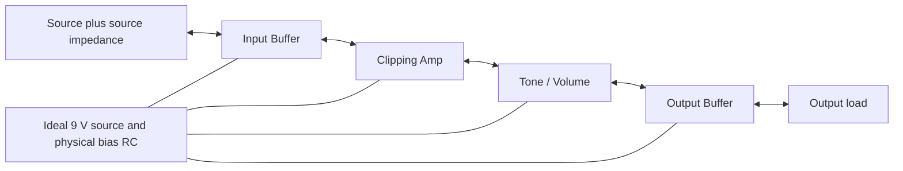

# TS808 circuit model: offline validation and real-time path

* **Author:** Project owner and Codex
* **Status:** Approved by the owner and finalized locally at `docs/designs/ts808_offline_design.md` on 2026-10-31, including all sections and the API/schema/fixture attachment. T1–T23 remain approved; predecessor reconciliation found no unresolved contradiction. No production implementation or validation has run; actual gate characterization remains outside the MVP and `egm-review` has not started.
* **Date:** 2026-10-31

## Overview

Build an offline C++ model of a selected classic TS808 circuit and compare its output and internal electrical behavior with LTspice. The first deliverable processes reproducible test signals and produces numerical evidence of agreement. Its purpose is to establish a trustworthy circuit model before spending effort on plugin packaging or component modifications.

Preserve input and output BJT buffers, the nominally symmetric silicon-diode feedback clipper, interacting RC networks, and Drive, Tone and Volume controls. Represent the JRC4558 through a nonideal behavioral macromodel rather than its internal transistor topology. The model must account for finite gain and bandwidth, slew limiting, input/output impedances and supply-dependent saturation. Nominal starting targets are 3 MHz gain-bandwidth product and 1 V/us slew rate; exact model parameters require a documented reference. Supply rails are 0 V and 9 V with nominal Vref of 4.5 V; output headroom must not be equated with the rails.

After the base model passes agreed accuracy gates, optimize it for real-time use while retaining the same validation evidence. TS9 and classic modifications follow successful accuracy and runtime gates. The eventual product remains a C++/JUCE VST3/CLAP plugin for live guitar monitoring.

## The Problem

A pedal model that reproduces a frequency curve or a static clipping function can still miss the way bias, capacitor charge, diode conduction, amplifier dynamics and stage loading interact. Without a fixed circuit reference and reproducible comparisons, a plausible sound does not establish component-level accuracy. Optimization can also change the sound without making the difference apparent.

The project needs a traceable path from one documented TS808 circuit to a numerical implementation, a repeatable LTspice comparison, and a measured real-time implementation. Agreement with LTspice validates agreement with the selected equations and device models; hardware fidelity remains limited by the quality of those models. Zero numerical error and equivalence to every historical pedal are not meaningful acceptance criteria.

## Goals

1. Freeze one classic stock TS808 reference, including schematic revision, component values, device models, control positions, source/load impedances, supply/bias assumptions, temperature and initial conditions. Preserve provenance and enough metadata to reproduce every comparison.
2. Process deterministic offline test signals using component equations that retain the requested nonlinear feedback, dynamic states and electrical loading, under the approved basic-semiconductor scope and solver architecture.
3. Compare DC operating points, small-signal Bode response, time-domain null residuals and THD/harmonic spectra against LTspice. Check reference convergence and distinguish circuit error from resampling/filter error. Apply the approved initial quantitative gates; complete the test-specific limits and matrix before accepting the model.
4. Preserve stimuli, configurations, reference outputs and reports so discrepancies can be located by stage and a run can be reproduced. Failed numerical convergence must be visible and cannot count as a passing result.
5. Include controlled ABX listening in the validation path, with its role, timing and statistical protocol defined in the Technical Plan. A listening result cannot replace numerical evidence.
6. After offline accuracy acceptance, demonstrate the validated base model under the approved real-time scenario: Ryzen 7-class desktop, 48 kHz base rate, 4x/8x oversampling candidates, one to four instances and 64/128-sample buffers. The target is below 5% CPU per instance under a defined benchmark and zero added latency if feasible, otherwise below 1 ms. Benchmark definitions remain to be fixed; these are targets, not achieved results.
7. Repeat accuracy checks after numerical and runtime optimizations before extending the circuit or exposing modifications.

## Non-Goals

* Simulating the JRC4558's internal transistor topology.
* Delivering TS9 variants, component substitutions, tolerance randomization or classic modifications in the offline MVP. These remain later product goals.
* Delivering the plugin UI or VST3/CLAP host integration as the offline MVP. Their interfaces and dependencies belong to later design stages.
* Claiming that LTspice agreement alone proves agreement with a physical pedal or guarantees perceptual equivalence.

Source sag is deferred by the approved ideal-source baseline; the physical bias RC network is included. Semiconductor parasitics are deferred by T14. T15 fixes static effect-on switching scope. T18 fixes a deterministic 25 degrees C baseline without stochastic noise or temperature drift; exact nominal-temperature parameters still belong to the reference package.

## Critical User Journeys (CUJs)

### CUJ 1: Reproduce a stock TS808 comparison

* **Given:** An identified TS808 reference package, documented LTspice version/device models, test stimulus, control settings, electrical boundary conditions and agreed acceptance thresholds.
* **When:** The developer runs the offline model and compares it with the corresponding LTspice exports.
* **Then:** The report identifies the exact inputs and models, shows DC/Bode/null/harmonic results, and marks every required case as passed, failed or not evaluated. Missing reference data or numerical failure cannot produce an overall pass. Circuit-only comparisons are distinguished from comparisons that include oversampling filters.

### CUJ 2: Locate a numerical discrepancy

* **Given:** A failed comparison with its saved stimulus, configuration and reference.
* **When:** The developer inspects corresponding named nodes, operating points, dynamic states and convergence records.
* **Then:** The evidence supports distinguishing reference/setup differences, device-equation errors, integration errors, nonlinear convergence failures and resampling differences. Diagnostic runs remain reproducible; observed errors are not hidden by arbitrary gain or EQ fitting.

### CUJ 3: Verify an optimization before promotion

* **Given:** A base model that passes the agreed offline suite and an optimized implementation of the same circuit.
* **When:** The developer repeats the accuracy suite and measures the approved runtime scenario.
* **Then:** Promotion requires both accuracy and performance acceptance. A speed improvement with failed accuracy cases remains unaccepted. TS9 and modifications remain outside the MVP until the base passes both gates.

## Technical Plan (Architecture)

**Section state:** Approved by the owner on 2026-10-31, including the initial reference maximum-step bound h/8 and subsequent decisions T1–T23. The [decision log](./ts808_decisions.md) preserves alternatives, rationale and detailed test obligations; the approved model/numerical/tooling/interface contracts supply the exact parameters and boundaries. No implementation or measured numerical/runtime result is claimed.

### Model boundary and physical scope

The MVP represents one selected stock TS808 audio circuit and its physical bias network. It uses ideal 0/9 V supply rails, with Vref determined by the divider, decoupling and connected loads. Input/output source and load impedances are explicit. The four audio stages are Input Buffer, Clipping Amp, Tone/Volume and Output Buffer. Shared bias infrastructure is solved with them.

The selected documentary source is the Cerutti TS-808 redraw linked by General Guitar Gadgets. T15 selects its effect-on audio path and supply/bias network, omitting the footswitch flip-flop logic while retaining audio/bias branch loads and an applicable finite conducting-switch equivalent. The [reference extraction record](./ts808_reference_candidate.md) fixes source identity and required checks; T21-A closes the on-resistance nominal. Native circuit generation and its terminal-map checks remain planned; static switch equivalence is not a claim of identical nonlinear hardware behavior.

The [model-data working contract](./ts808_model_contract.md) documents the passive/active terminal audit, switching crossover and resistance-track orientations. T19 selects revised option B: the saturation transfer is exactly the identity in a finite central interval, joined with continuous value and first derivative (C1) to compression knees near the headroom-adjusted output limits, with recovery feedback inside the coupled solve. The original global amplitude tanh is superseded. T20-A fixes the shifted-tanh outer law, giving C2 joins, and the nominal model parameters below. Supply rails remain 0 V/9 V with the accepted nominal headroom. T21-A closes the finite switch resistance; numerical/tooling and final plan readiness remain open.

The owner approved [T20-A and its nominal package](./ts808_model_data_proposal.md): shifted tanh only in the outer knees, analytical derivatives, 0.25 V knee spans, headroom `37/51 V` per rail, effective output resistance `10000/51 Ohm`, recovery constant 10 us and the remaining stated op-amp nominal vector. The approval includes reduced 1N914/representative 2SC1815-GR data with explicit temperature preparation and provenance. Rational knees are unselected. JFET resistance was excluded from T20 and subsequently closed by T21-A as a conditional static nominal; source estimates/assumptions remain distinct from physical measurements.

The owner approved [T21-A](./ts808_switch_resistance_proposal.md): use `R_on=383.29731360711594 Ohm` (383.30 Ohm displayed) from `wet_send` to `switch_common` in both independent realizations, under the documented unit-area, 25 degrees C, `V_GS=0` and `V_DS=0` model-core assumptions. Actual gate characterization is outside the MVP; its absence is a physical limitation, not an open model value. No dynamic JFET, ideal gate source or changed loading is introduced. The approved mathematical baseline is identified as `ts808-cerutti-reduced-v1`; actual artifact hashes follow when those files are authored.

| Element | Accepted baseline | State and derivative obligations |
| --- | --- | --- |
| External resistors and capacitors | Preserve the selected schematic's values, connections and control networks, including the feedback capacitor. | Resistor conductances and capacitor trapezoidal stamps; every capacitor has one state/history owner. |
| Feedback diodes | Shockley current laws, nominally symmetric antiparallel pair; explicit matching parameters in C++ and LTspice. | Analytical conductance; no junction/diffusion charge or internal series resistance in the MVP. |
| Input/output BJTs | Basic Ebers–Moll, including forward/reverse conduction and finite current gains. | Analytical terminal-current derivatives and KCL; no internal resistance, charge or Early effect. |
| Both JRC4558 channels | Independently implemented C++/LTspice realizations of one documented nonideal behavioral specification; T20-A fixes shifted-tanh outer knees with C2 joins and the nominal vector within T19 revised B. | Finite gain/bandwidth, slew, input/output impedances and saturation/recovery inside feedback; independent state per channel. Preserve exact central identity and accepted rail headroom; verify the selected law/parameters. |
| Supply and bias | Ideal source at 9 V, actual bias/supply-path RC components from the frozen circuit. | Shared node KCL and physical capacitor history; no independent ideal 4.5 V source per stage. |

Semiconductor parasitics are intentionally excluded from this baseline. Rs, VAF and device charge remain possible refinements after MVP validation. Removing them eliminates those modeled states; it neither proves their physical insignificance nor eliminates all remaining stiffness. The accepted numerical tests establish agreement for the simplified circuit, not every physical TS808.

For a diode, i = Is expm1(v/(n VT)) and g = Is exp(v/(n VT))/(n VT), where VT = kT/q. Reuse the exponential terms with consistent stable evaluation. For an NPN Ebers–Moll device, one explicit terminal-current convention, with all currents into the device, is:

```text
F = I_ES expm1(V_BE / (N_F VT))
R = I_CS expm1(V_BC / (N_R VT))
I_C = alpha_F F - R
I_E = -F + alpha_R R
I_B = (1 - alpha_F) F + (1 - alpha_R) R
```

The parameters must satisfy the chosen Ebers–Moll reciprocity convention and match the effective SPICE current laws. Differentiate through V_BE = V_B - V_E and V_BC = V_B - V_C; verify I_B + I_C + I_E = 0 independently. The exact parameter card, temperature and omitted terms must be explicit. A native transistor model name alone is insufficient: audit simulator defaults so the LTspice reference does not enable absent C++ effects. Diodes/BJTs have no charge states in this approved baseline; derivative tests for their omitted charge reduce to zero-contribution checks.

### Component ownership and data flow



Arrows describe electrical interaction, not four sequential independent audio calls. Assign every coupling component once. Joined nodes share voltage and the sum of oriented terminal currents is zero. Shared Vref can couple nonadjacent stages. Choose retained boundary unknowns from the actual graph so any internal block elimination is valid.

The C++ processing core owns device evaluation, block assembly, coupled solves and committed state. It receives already prepared circuit parameters, source/control values and timestep information. It performs no reference import, plotting, file access or host interaction. The offline executable handles configuration, model execution and trace/diagnostic output. Python imports references, reconstructs them at the C++ timestamps and measures/reports errors. These are the same model equations intended for the later plugin; runtime readiness still requires measurement.

The component interfaces must support residual-only evaluation for tests and residual-plus-analytical-Jacobian evaluation for Newton. Trial evaluation must not mutate history. A block supplies its local residual/Jacobian and node mapping; a coordinator owns global assembly and commit. Concrete C++ signatures, trace serialization and CLI flags will be fixed in the Detailed Implementation Plan rather than inferred by an implementer.

T17 selects standard-library binary trace writes plus JSON sidecars in the offline layer. The [data contract](./ts808_data_contract.md) and [concrete interface specification](./ts808_offline_interface_spec.md) fix the process boundary, exact 31-quantity order, row-major little-endian float64 layout, API/schema obligations, integrity and failure semantics for implementation-section review. NumPy fromfile loads an array; memmap provides mapped access. Neither implies that reconstruction/FFT avoids all copies or allocations.

### Coupled fixed-step solver

Use modified nodal analysis with trapezoidal integration at a declared constant h. With d q(x)/dt + f(x,u) = 0, solve:

```text
F_n = q(x_n) - q_previous + (h/2) [f(x_n, u_n) + f_previous] = 0
J_n = dq/dx(x_n) + (h/2) df/dx(x_n, u_n)
```

These expressions describe the dynamic residual rows. Pure algebraic constraints impose the current-step equations directly, with consistent residual/Jacobian scaling; do not carry a previous KCL error as physical charge history.

Previous-step terms are immutable during all trials for the current step. The model uses one coupled Newton iteration with analytical device stamps. It does not solve each stage independently and accept incompatible port values. In the partitioned linearization, y contains internal unknowns and b shared/boundary unknowns:

```text
A dy + B db = -r_internal
C dy + D db = -r_boundary
S = D - C solve(A, B)
S db = -r_boundary + C solve(A, r_internal)
dy = solve(A, -r_internal - B db)
```

Factor and solve; never construct explicit inverses. Reuse valid internal factorizations within the iteration. Reuse between iterations only when the matrix is actually unchanged. Singular/ill-conditioned internal elimination requires partition/pivot diagnostics, not a silently modified physical model. Retain a full assembled linear-solve diagnostic for checking the Schur result on the same iterate.

Per step, read committed history; evaluate local residuals/Jacobians; assemble the shared system; solve and apply the complete Newton increment under the selected damping rules; check the full scaled nonlinear residual and increment; commit all device histories together only after convergence. The grouped numerical contract below supplies the selected initial precision, scaling, work limits and implementation route; remaining pins and conditioning details must be fixed before implementation readiness.

T16 selects Eigen with fixed-size binary64 matrices and pivoted LU; the [numerical contract](./ts808_numerical_contract.md) groups initial scaling/tolerances, 32 transient Newton iterations, 100 DC iterations and at most 9 line-search trial lengths per iteration for the offline baseline. T22-A fixes the node/interface map and dimensions below. Verify no processing-path allocations, including failures; timing and memory claims require tests.

The owner approved [T22-A and its common criteria](./ts808_numerical_closure_proposal.md): one fixed system of 31 unknowns, with four interiors of 4/6/11/5 and boundary `[input_emitter, clip_out, wet_send, vref, i_volume_low]`. Five control-segment current equations preserve exact zero-resistance endpoints. The accepted `control-branch-v1` contract includes 1 V/1 mA reference scales, pivot threshold `64*N*epsilon`, finite `rcond>=1e-12`, full backward error `<=1e-10`, Schur/full increment agreement `<=1e-9` and the documented DC guess/API/fixture obligations. These are initial qualification requirements, not measured results. T22-B is unselected; no endpoint-map or full-solve fallback is introduced.

A linear capacitor uses G = 2C/h and i_n = G v_n - G v_previous - i_previous. Both v_previous and i_previous are committed quantities. Op-amp states require consistent trapezoidal history for their actual nonlinear differential laws. No silent switch to Euler/BDF2, adaptive steps, sample interpolation repair or waveshaper fallback is permitted.

After exhausted bounded solving, stop the offline case and retain the last valid state plus failure diagnostics. A new whole-case run at a finer h is separately identified; it cannot replace the failed result. Partial waveforms remain diagnostic and cannot count as complete passing null/THD cases. The future live plugin's audible failure handling is a separate design concern.

### Initialization and numerical runs

Initialize every baseline case from a verified DC equilibrium of the entire loaded circuit at its declared pre-stimulus input and controls. Capacitor currents are zero at equilibrium; stored charge follows solved voltages. Both op-amp states satisfy their steady-state laws. Do not force Vref to 4.5 V during initialization. An unchanged-input hold test checks for spurious drift.

Cold power-up is outside the MVP. Signal onset, clipping and overload/recovery from the settled state remain required. Analysis windows and warm-up intervals are declared in advance; no post hoc trimming may hide initialization error. Failed DC initialization prevents a transient comparison from starting.

The runtime targets motivate fixed-rate validation at 192 kHz and 384 kHz (4x/8x of 48 kHz), with separately identified finer fixed-rate runs for temporal convergence. Circuit-only tests use electrical stimuli in volts at declared sample times. Later end-to-end tests include interpolation/decimation explicitly; a circuit-only null cannot establish their alias/phase performance.

### LTspice and reconstruction protocol

Use a versioned circuit/reference package: selected schematic and topology mapping, component/model values, source/load, controls, temperature, stimulus definitions, solver settings and initial conditions. Both execution paths use that declared circuit. C++ output never generates the expected LTspice waveform.

Required reference directives are:

```spice
; Reference protocol specification
.options plotwinsize=0
.options reltol=1e-6
.options numdgt=15
```

The owner requires numdgt≥7; 15 is the concrete compliant value. Maximum integration step must be below the oversampled period h. The approved initial bound is h/8, about 651.042 ns at 4x and 325.521 ns at 8x, with subsequent refinement. Use `.tran 0 {Tstop} 0 {Tmax}` with actual case parameters. Preserve settled initialization without `uic` or `startup`. Plot interval alone does not set the maximum integration step.

Record LTspice version, integration/modified-trap setting, absolute current/voltage/charge tolerances, transient error controls and effective netlist. Qualify references by smaller maximum steps and tighter tolerances, initially comparing reltol=1e-6 to 1e-7. The h/8 starting bound is approved; the bound alone is not proof of convergence.

Python reads binary RAW through a pinned spicelib.RawRead, retaining original RAW/log/netlist/model hashes. Select the declared analysis/step/nodes; check actual float64 trace storage, time axis, units, complex AC values and file integrity before conversion. Unsupported/corrupt or lower-precision reference data cannot pass by being cast to float64. RAW parsing remains an analysis dependency, not plugin code.

T23-B fixes the [common tooling and native producer](./ts808_execution_tooling_proposal.md). C++/Python run in WSL 2; LTspice runs natively on the same Windows host through PowerShell/WSL interoperability. Stage small hashed inputs into a new Windows-drive workspace, use a Windows working directory and read the original closed RAW/log through the shared path. No manual transfer or Wine qualification is required. Native process ownership/timeout, path translation, completion and reference uncertainty still require implementation evidence.

Reconstruct timestamped node data with scipy.interpolate.PchipInterpolator on t_n = t_origin + n h, with no extrapolation or fitted time shift. Validate monotone source times and stepped-case identity. PCHIP preserves the supplied data's monotonicity; it does not prove that intermediate peaks were resolved or guarantee a specific dB error. Qualify it on analytic irregular-grid fixtures and refined circuit traces, including extrema and clipping/slew transitions.

WAV tests remain parallel, with explicit rate/encoding/channel map, DC treatment and a fixed volts-to-full-scale scale. Reject clipping and independent per-waveform normalization. Numerical node data are the primary evidence; a numerical pass does not automatically validate WAV export. The decision log contains [primary-source links](./ts808_decisions.md) for LTspice, spicelib and interpolation behavior.

### Measurement and unit-test responsibilities

The approved initial acceptance gates are:

| Check | Initial gate | Qualification |
| --- | --- | --- |
| Key-node DC | Absolute voltage error ≤10 mV. | Node list and sensitive-node refinements still need the frozen circuit. |
| Small-signal Bode | Magnitude error ≤0.2 dB and phase error ≤2 degrees, 20 Hz–20 kHz. | T18 fixes the 301-point grid, transfer-zero rule, linearity checks and actual-rate discrete response. |
| Steady circuit null | Residual RMS ≤−60 dB relative to reference RMS and peak ≤−40 dB relative to reference peak. | Both must pass. Below reference RMS 1 mV, use absolute 1 uV RMS/10 uV peak. No arbitrary EQ, gain fitting or time warping. |
| Harmonics / THD | Selected harmonics above −80 dBc within 1 dB; THD relative error ≤5% above the measurement floor. | T18 fixes the bandwidth, harmonic/floor rules and 82/440/1000/5000 Hz tone matrix. |
| Numerical completion | Every required case completes with valid DC and transient solves. | Missing/unqualified reference and incomplete cases cannot pass. |

The aggregate reference uncertainty is at most one tenth of the corresponding acceptance error budget. This means −80 dB RMS and −60 dB peak for the relative steady-null reference-change limits, with explicit absolute floors near silence. Integration, stored precision and reconstruction share that budget; each cannot independently consume it in full. Reference qualification and C++ timestep convergence are separate evidence.

Python computes spectra with NumPy FFT facilities using declared sample count, window/coherent gain, DC treatment, bin mapping and normalization. Independent analytic fixtures verify volts, harmonic amplitudes and summed-power THD. T18 approves the [validation matrix](./ts808_validation_contract.md): 25 degrees C, 1 kOhm source/1 MOhm load, 27 DC/Bode control combinations with 301 frequencies, and 36 physical transient cases at both 192/384 kHz plus one listening case. It fixes discrete-time Bode/floor rules, small-signal/settling checks, local onset/overload null windows, DC-hold drift and recovery timing. The final case manifest must expand these accepted definitions without choosing new test conditions.

T18 also approves calibrated parallel WAV qualification and human 20-trial concealed ABX with the declared binomial/Holm analysis. Numerical acceptance, WAV qualification and listening remain separate outcomes; unperformed ABX leaves combined MVP validation pending, and nonsignificance does not establish perceptual equivalence. The common offline listening FIR does not select the later plugin's oversampling filter or latency. These are accepted requirements, not completed tests or listening results.

Automated tests must exercise the actual C++ analytical Jacobians against finite differences of the residual-only evaluation. Cover both diode polarities, BJT conduction regimes, op-amp linear/slew/saturation branches, external capacitors/history and full block assembly. Use scaled smooth-point central differences over multiple perturbation sizes, with separate one-sided tests for the documented piecewise boundary conventions. Include zero contributions from omitted semiconductor charge, expected zero matrix entries, terminal KCL and rejected-trial immutability. Fixed parameters/history during perturbation are mandatory.

For T19 revised B, verify exact central identity and zero central recovery contribution, then value/first-derivative continuity from both sides of each knee join. The derivative at each join is 1. Continuous derivatives support the intended deterministic bounded solver behavior and C++/LTspice comparison; convergence, conditioning and passing null results still require the existing numerical evidence.

Compare Schur and full-system Newton increments independently at the same valid linearization. Report device/state/entry/perturbation diagnostics for derivative failures. A derivative match cannot prove that the residual is physically correct; device-law tests and LTspice comparison remain required. The [decision log](./ts808_decisions.md) preserves the full owner-requested unit-test contract. Test files, runner and numerical constants will be enumerated in the implementation section; no test code has been written yet.

### Staging and unresolved implementation contracts

Deliver the fixed stock offline model and its validation evidence first. Optimize the validated core toward the stated real-time budget next, repeating accuracy checks. Add TS9/modifications after both gates. Host wrappers, component customization and live recovery do not enter the offline MVP by accident.

T1–T23 close the model, numerical and tooling choices. The owner approved the concrete interface/schema/fixture attachment and unified implementation section. Actual tool installation/hashes, native-file encoding, resource use and qualification results are future evidence, not unresolved architecture silently delegated to an implementer.

## Alternatives Considered

**Section state:** Approved by the owner on 2026-10-31. This section uses the predecessor's Alternatives Weighed and decisions T1–T14. Rejection means a requirement is unmet; not selected means another defensible route was chosen for this MVP; deferred means a later-stage scope item. No performance comparison has been run.

### Circuit representation and model scope

| Alternative | Benefit | Cost or limitation | Disposition and reason |
| --- | --- | --- | --- |
| Static waveshaper as the complete pedal | Small processing cost and a simple nonlinear transfer curve. | Does not preserve the requested RC history, electrical loading or active feedback. | Rejected as the complete solution because it does not meet component-level modeling goals. It may remain a diagnostic baseline. |
| Ideal op-amp followed by an output clipper | Simple equations and saturation behavior. | Applying limiting after an ideal circuit solve omits its effect on the feedback loop and amplifier state. | Rejected as the final model because the requested nonideal dynamics must participate in the solve. |
| Transistor-level JRC4558 internals | Can represent a much larger set of internal mechanisms if the topology and parameters are known. | More unknowns, device data and validation work than the requested external-behavior model. | Excluded by the owner's explicit scope decision; use a behavioral macromodel for both channels. |
| Semiconductor charge, internal resistances and Early effect in the first MVP | More device behavior than the basic laws. | Adds parameters and possibly dynamic states, complicating the initial reference and derivative suite. | Deferred by T14. The baseline deliberately matches basic Shockley/Ebers–Moll laws in both implementations; its physical limitations remain explicit. |
| Ideal 4.5 V reference in place of the bias network | Fewer shared unknowns and simpler coupling. | Removes bias loading and RC dynamics. | Not selected in T4; retain the physical bias network. |
| Finite-impedance battery/adapter source for the MVP | Includes source sag and related interactions. | Requires an additional source model and validation envelope. | Deferred in favor of the approved ideal-source baseline. Physical supply-path components in the chosen schematic remain included. |

### Numerical formulation and execution

| Alternative | Benefit | Cost or limitation | Disposition and reason |
| --- | --- | --- | --- |
| Reduced nonlinear state space | Can reduce the size of a fixed-topology solve. | Requires elimination/reconstruction and careful treatment of controls and model changes. | Not selected in T1. MNA was chosen for correspondence to circuit nodes; reconsider reduction only from measured accuracy/cost evidence. |
| Wave digital filters | Component-oriented structures and reusable passive-network adaptors. | Active feedback, multiple nonlinear devices and the selected op-amp/BJT scope still need coupled treatment. | Not selected in T1. Remains a possible future route; no claim that it cannot model the circuit. |
| Independent local Newton solves with iterative port exchange | Strong stage-level solver separation. | Requires outer interface convergence as well as local convergence. | Not selected in T2. Coupled Newton with block elimination preserves one global linearized update and explicit current balance. |
| Naive explicit integration | Avoids an implicit solve in some formulations. | Stability and error can depend strongly on unresolved fast modes. | Rejected as the default without a stiffness/stability analysis; it does not replace the accepted implicit formulation. |
| Backward Euler or fixed-step BDF2 as the primary integrator | Damping of unresolved fast behavior; BDF2 offers second-order behavior for smooth solutions. | Numerical damping and, for BDF2, additional history/startup rules. | Not selected in T3. Use trapezoidal integration and test for its ringing/error; neither alternative is a silent fallback. |
| Subdivide a failed timestep | Can recover some difficult offline intervals. | More work and variable-step/history/stimulus handling; recovered output does not establish convergence at the target fixed rate. | Not selected in T5. Stop the failed case and use separately identified whole-case refinement runs. |
| Automatic differentiation for production Jacobians | Ties derivatives to executable residual expressions. | Adds an implementation/dependency choice and derivative-propagation work. | Not selected in T13. Use analytical stamps for the closed catalog, with automated finite-difference checks. |

### Reference and analysis pipeline

| Alternative | Benefit | Cost or limitation | Disposition and reason |
| --- | --- | --- | --- |
| Third-party/vendor op-amp SPICE model as the primary null target | Supplies a separately sourced external model. | Can differ from the compact C++ model in mechanisms and supported conditions, mixing model error with solver error. | Not selected in T6. Independently implement one documented behavioral specification; use external evidence separately for physical characterization. |
| Cold power-up in the initial acceptance suite | Tests charging and low-supply behavior. | Requires explicit non-equilibrium initial conditions and a valid model during the supply ramp. | Deferred by T7. Begin at a verified loaded DC operating point; signal onset and overload recovery remain in scope. |
| WAV as the primary circuit-null reference | Direct connection to playback and DAW workflows. | Adds encoding, scaling, clipping and reconstruction effects, and lacks the full internal-node evidence. | Not selected in T9. Use high-precision timestamped nodes as primary evidence and keep WAV checks in parallel. |
| Cubic-spline reference reconstruction | Smooth piecewise reconstruction. | Can overshoot between samples near sharp transitions; boundary behavior requires qualification. | Not selected in T10. PCHIP was chosen for shape preservation and still requires error qualification. |
| C++ for both model and analysis | One compiled tooling stack. | Requires integrating and independently validating more measurement/reconstruction code. | Not selected in T11. Reuse NumPy/SciPy for offline measurements while retaining the reusable C++ circuit core. |
| Tabular text as the primary LTspice import | Human-readable and accessible through ordinary numerical-table tools. | Larger data and an additional export/format/precision contract. | Not selected in T12. Use binary RAW through spicelib.RawRead; text may aid inspection but is not a silent fallback. |

### Later-stage options retained

FIR and low-latency IIR oversampling filters remain candidates for the later end-to-end/runtime stage. Neither has been rejected or selected by the circuit-only MVP design; their phase, latency and aliasing need measurements. Building all solver formulations is not part of the approved MVP.

The brainstorm also mentioned a generic topology editor, automatic adaptive oversampling and remote telemetry. They have no implementation requirement in this design and remain unselected proposals rather than newly approved product features. TS9, component tolerances and classic modifications remain the accepted later destination after base accuracy and runtime acceptance.

## Open Questions

**T1–T23 and all design sections/attachments are approved.** The [predecessor reconciliation](./ts808_predecessor_reconciliation.md) found no unresolved contradiction with accepted requirements; material additions are covered by explicit decisions and the implementation-section approval. Actual gate characterization remains outside the MVP. The owner selected `docs/designs/ts808_offline_design.md` for the finalized design; no drafting decision remains open.

`egm-review` has not started and is not authorized by a drafting approval alone. Tool binary hashes, dependency resolution, native RAW compatibility, reference uncertainty and all numerical/ABX outcomes are evidence to collect during later authorized implementation, not results asserted by this design.

Later runtime machine/host/CPU and latency definitions, plugin filters/aliasing, state compatibility, release platforms/hosts and distribution licensing remain in the real-time/product stage. They are not prerequisites for approving this offline implementation plan. A passing simplified model would not establish physical TS808 or real-gate calibration.

## Additional Resources

* [Predecessor concepts brief](../../concepts_brief.md).
* [Published local RFC](./tube_screamer_rfc.md).
* [Goldfish review report](../../goldfish_review_report.md).
* [Accepted architecture decisions and detailed protocols](./ts808_decisions.md).
* [Implementation working inventory](./ts808_implementation_working.md).
* [Reference circuit candidate and extraction boundary](./ts808_reference_candidate.md).
* [Circuit terminal audit and approved T19 revised-B saturation contract](./ts808_model_contract.md).
* [Approved T20-A knee equations and nominal-data contract](./ts808_model_data_proposal.md).
* [Approved T21-A conditional conducting-switch resistance](./ts808_switch_resistance_proposal.md).
* [Approved T22-A numerical map and common criteria](./ts808_numerical_closure_proposal.md).
* [Approved T23-B tooling and same-host WSL/native Windows producer](./ts808_execution_tooling_proposal.md).
* [Concrete offline API, artifact/schema, case and fixture specification](./ts808_offline_interface_spec.md).
* [Completed predecessor reconciliation and approval provenance](./ts808_predecessor_reconciliation.md).
* [Grouped numerical execution contract](./ts808_numerical_contract.md).
* [Grouped offline data/tooling contract](./ts808_data_contract.md).
* [Approved grouped validation matrix](./ts808_validation_contract.md).

## Non-Functional Requirements

The offline core must use the accepted fixed-capacity storage and bounded work. Test allocations in the first prepared step, steady stepping, line searches and failures with both Eigen and application guards; do not infer this property from matrix templates alone. File/JSON/report/FFT operations are outside that path. The later plugin wrapper, CPU target and latency require separate qualification.

Reference production uses one owned native Windows process at a time, on the same WSL host. Use explicit executable and translated drive paths, a native working directory, immutable hashed inputs and completion only after files close. Timeout/cancellation must target the invocation's owned PID tree; a visible RAW or an exited Linux launcher is not proof of completion. Preserve interrupted artifacts as incomplete. No Wine, remote service or manual transport requirement enters this baseline.

Numerical results must be reproducible from actual source/spec/configuration/tool identities and the fixed cases. Keep physical and execution identities separate; reject stale/unqualified evidence. Preserve original RAW bytes and actual encoding. Do not claim cross-platform bit identity, zero allocation in Python, native-process compatibility, accuracy or resource limits before measurement.

Pilot reference point counts, wall time, disk use and analysis memory before the full suite. Compression stays disabled. Core output size is mechanically known as `8*written_samples*32` bytes; native adaptive point counts and Python workspaces are measured. Preserve retained small fixture files, while excluding generated build/environments/large runs from source tracking. There is no cold startup, source sag, real-gate characterization or plugin rollout in this MVP.

## Detailed Implementation Plan

**Section state:** Approved by the owner on 2026-10-31, including the complete interface/schema/fixture attachment, with the instruction "aprovo o plano e seu anexo para avançar à reconciliação com o predecessor". T1–T23 remain approved. All listed code/configuration/deck/fixture files are planned, not created. No build, native simulation or acceptance test has run. Implementation requires leaving this design-only workflow after finalization and the separately requested design review.

### Fixed contracts and component interfaces

Implement the approved `ts808-cerutti-reduced-v1` physical baseline, `control-branch-v1` numerical formulation and `wsl2-windows-native-v1` execution profile. The [interface specification](./ts808_offline_interface_spec.md) is normative for exact 31-unknown ordering, 12 capacitor histories, C++20 prepare/DC/evaluate/advance/read declarations, typed failure behavior, eleven schema contracts, trace/response layouts, local native request/result publication and explicit case/fixture recipes.

The source graph/nominals and the independently authored native component laws follow the [model contract](./ts808_model_contract.md), [T20](./ts808_model_data_proposal.md) and [T21](./ts808_switch_resistance_proposal.md). Follow [T22](./ts808_numerical_closure_proposal.md) for all exact endpoints, partition/scaling/conditioning and the deterministic DC guess. The raw import, uncertainty/measurement/WAV/ABX rules follow [T18](./ts808_validation_contract.md), the [data contract](./ts808_data_contract.md) and [T23-B](./ts808_execution_tooling_proposal.md). No absent value, file format, test family or new dependency is delegated as an implementation choice.

### Unified target-file inventory

Paths are relative to the project root. Every entry is a planned create unless marked Modify; no deletion is planned. A grouped row applies the stated change/reason to every explicitly named file. Tiny RAW/log files are generated later by the selected native producer, not fabricated numerical truth. Runtime artifacts under unique run directories are specified separately below.

| Order | Files | Planned change and reason | Dependency / evidence |
| --- | --- | --- | --- |
| 1 | `reference/ts808/README.md` | Identify the Cerutti schematic, approved effect-on boundary, source identity and scope limitations. | T15 source selection is complete; apply the [extraction rules](./ts808_reference_candidate.md). |
| 2 | `reference/ts808/component_map.json` | List every included component, terminal/node, value/unit, block owner and extraction difference, including retained switching-branch loads and finite switch equivalents. Preserve named trace correspondence. | Frozen reference graph, switch truth table/on resistance, actual values and agreed JSON contract. |
| 2a | `schemas/component_map.schema.json` | Formalize component/node/device/provenance/trace-map fields and reject missing or ambiguous model identities. | Concrete interface specification and approved T15/T20/T21 model baseline. |
| 3 | `reference/ts808/device_spec.md` | Carry the accepted Shockley/Ebers–Moll conventions, T19 revised B/T20-A exact knee equations and C2 joins, recovery/headroom, nominal vector/temperature preparation and T21 static switch assumptions. | Approved model contract and concrete interface specification; no global amplitude tanh or hidden defaults. |
| 4 | `reference/ts808/models.lib` | Independently encode the reduced diode/BJT behavioral currents and both stateful op-amp subcircuits, with explicit current returns and omitted effects. | Equivalence to the accepted specification; no undeclared native junction charge/resistance/Early defaults. |
| 5 | `reference/ts808/ts808.cir` | Connect the frozen effect-on circuit, bias network, source and load; expose named comparison nodes. | Reviewed component map/model definitions. |
| 6 | `reference/ts808/cases.json` | Define the finite DC/AC/transient/null/harmonic/overload matrix, stimuli, controls and analysis windows. | Completed input/load and validation contract. |
| 6a | `reference/ts808/check_diode.cir`, `reference/ts808/check_bjt.cir`, `reference/ts808/check_opamp_dc.cir`, `reference/ts808/check_opamp_transient.cir` | Independently author native standalone model-law fixtures at the exact oracle points/loads/timing in the interface specification. | T13/T14/T20 independent current-law checks and same-host T23-B producer. |
| 6b | `validation/tests/test_device_reference.py` | Check native standalone currents/states against independent mathematical oracles and the existing reference budget. | Actual native producer required; manufactured Python results cannot count as simulator parity. |
| 7 | `include/ts808/types.hpp` | Declare the exact 31 ordering, 12-capacitor histories, numerical settings/diagnostics/outcomes and fixed-size binary64/complex types. Keep host/file concerns outside the core. | Approved C++20/T22 map and the concrete interface declarations. |
| 8 | `include/ts808/parameters.hpp` | Hold prepared immutable component/model parameters and supported ranges. | Frozen model values and run configuration contract. |
| 9 | `include/ts808/devices.hpp`, `src/devices.cpp` | Implement resistor/capacitor, Shockley, Ebers–Moll and behavioral op-amp residuals and analytical stamps. Reuse evaluated junction terms. | Model equations and boundary conventions; per-device derivative tests. |
| 10 | `include/ts808/stages.hpp`, `src/stages.cpp` | Assign components/unknowns to the four blocks and shared bias infrastructure; assemble local terms and oriented port contributions. | Audited topology map, one owner per component/history. |
| 11 | `include/ts808/block_solve.hpp`, `src/block_solve.cpp` | Factor fixed 4/6/11/5 interiors and the five-unknown Schur boundary, back-substituting without inverses and checking full backward error. | T16/T22 dimensions, pivot/scaling/condition rules and fixed diagnostics; no automatic full-solve fallback. |
| 12 | `include/ts808/newton.hpp`, `src/newton.cpp` | Perform bounded coupled Newton, convergence tests and trial-state handling. Report DC versus transient failures explicitly. | Numerical contract: caps, damping, tolerances, permitted DC aids. |
| 13 | `include/ts808/model.hpp`, `src/model.cpp` | Implement the specified prepare/DC/advance/read lifecycle, accepted initial guess, fixed trapezoidal steps and transactional history. Latch a failed case until new preparation. | T5/T7/T22 and exact interface declarations; no cold startup or retry repair. |
| 13a | `include/ts808/linear_response.hpp`, `src/linear_response.cpp`, `tests/linear_response.cpp` | Derive continuous and actual-rate discrete small-signal responses from the frozen circuit/DC linearization; verify trapezoidal recurrence and algebraic constraints. | Approved T18 Bode gate; continuous AC cannot replace discrete-time qualification. |
| 14 | `app/offline_main.cpp` | Validate inputs, prepare the core, execute one identified case and return a machine-readable outcome. | Final CLI/run contract, without invented flags. |
| 15 | `app/run_io.hpp`, `app/run_io.cpp` | Read configuration, write explicit row-major little-endian float64 traces through standard stream I/O, and persist JSON metadata/diagnostics outside the core. | T17 data contract; no native-struct/Eigen memory dump. |
| 16 | `tests/test_main.cpp` | Register/run automated C++ tests through the accepted Catch2 runner and CTest. | T23 Catch2 3.16.1, matching normal/checked build targets. |
| 17 | `tests/device_jacobians.cpp` | Check analytical entries/directional derivatives against independent finite differences over declared branches/regimes and step sizes. Include T19 value/first-derivative continuity from both sides of both knee joins, with join derivative 1. | T13/T19 obligations, numerical tolerances, frozen knee definitions and residual-only access. |
| 17a | `tests/fixtures/opamp_revised_b_cases.json`, `tests/fixtures/device_nominal_25c.json` | Named fixture vectors for T20-A's exact central identity, C1/C2 knee joins and reduced semiconductor currents, including source/prepared-temperature identities. | Approved T20-A; expand exact scalar/regime fixtures before implementation signoff. No fixture has been created. |
| 18 | `tests/linear_and_history.cpp` | Verify RC limits, KCL, zero omitted semiconductor charge, DC hold and no history mutation on rejected trials. Verify T19 exact central saturation identity and zero recovery contribution throughout that interval. | Device/state invariants independent of the main null; approved central-linearity requirement. |
| 19 | `tests/coupled_solver.cpp` | Compare Schur/full linear increments and test port KCL, singular diagnostics, global commit and stop-on-failure. | Numerical contract and known valid/failing fixtures. |
| 19a | `tests/allocation_guard.cpp` | Assert no prepared-step allocation, including first step, line search and failure diagnostics; combine Eigen's guard with an application-level allocation check. | T16 and actual pinned Eigen behavior; preparation/file I/O outside the guarded region. |
| 19b | `tests/control_endpoints.cpp`, `tests/conditioning_and_scaling.cpp` | Qualify T22-A's exact zero-resistance constraints, all T18 control triples, fixed partition and accepted rank/condition/scaling criteria. | Approved T22-A; tests have not run and no B aliases/maps are required. |
| 19c | `tests/fixtures/numerical_layout_cases.json`, `tests/fixtures/numerical_failure_cases.json`, `tests/fixtures/dc_guess_cases.json` | Enumerate the fixed 31-unknown map/counts, manufactured algebraic failure cases and accepted deterministic starting guesses with explicit expected outcomes. | Approved T22-A; distinguish these specified fixtures from measured simulator goldens. |
| 20 | `validation/pyproject.toml`, `validation/requirements.lock` | Define and pin the Python analysis environment: NumPy, SciPy, spicelib and selected report/test dependencies. | Version/platform verification; lock-generation method and hashes fixed before use. |
| 20a | `validation/bootstrap-requirements.lock` | Freeze accepted pip/pip-tools bootstrap and its resolved dependencies/hashes separately from analysis. | Approved T23 common package; no tools have been installed or lock generated. |
| 21 | `validation/ts808_validation/__init__.py`, `validation/ts808_validation/cli.py` | Expose the analysis entry point and orchestration, with explicit case/result identity and return semantics. | Data/tool contract; process boundary to the C++ executable. |
| 21a | `validation/ts808_validation/__main__.py` | Provide the specified Python module command entry point. | T17 command contract. |
| 21b | `schemas/case.schema.json`, `schemas/run.schema.json`, `schemas/report.schema.json` | Specify version-1 case metadata, binary sidecar and numerical outcome/provenance structures. | T17; fixed names/types/units and explicit unknown-version rejection. |
| 21c | `validation/ts808_validation/artifacts.py`, `validation/tests/test_artifact_contract.py` | Finalize hashes, validate binary length/layout and metadata, and qualify round-trip/incomplete/truncated artifacts. | T17; Python hashlib owns integrity finalization, with no C++ cryptographic implementation. |
| 21d | `validation/toolchain.json`, `schemas/toolchain.schema.json` | State `wsl2-windows-native-v1`, accepted root versions, paired Windows/WSL shared paths and native simulator policy; collect actual executable/environment identities at setup. | Approved T23-B with the same-host WSL clarification; no Wine runtime or remote producer. |
| 21e | `schemas/failure.schema.json`, `schemas/reference_request.schema.json`, `schemas/reference_result.schema.json`, `schemas/abx_session.schema.json` | Fix typed failure, local native producer request/result and blinded session/key structures with explicit completion/provenance rules. | Mechanical schema expansion of T17/T18/T22/T23 in the interface specification; no new data container/runtime. |
| 21f | `schemas/imported_reference.schema.json`, `schemas/suite_summary.schema.json` | Define version-1 reference.json and summary.json, original-file locators/hashes, nominal/refined linkage and complete suite outcomes. | A-001 / IMP-001; normative persisted handoff in the interface specification. |
| 22 | `validation/ts808_validation/reference.py` | Import the declared RAW plot/step/nodes through spicelib, retaining source precision and metadata; reject invalid input. | Pinned reader qualified against real simulator fixtures. |
| 22a | `validation/ts808_validation/simulator.py`, `validation/tests/test_simulator_contract.py` | Stage small inputs into the shared Windows directory, invoke the helper through WSL and qualify original closed RAW/log; test path translation/quoting, hashes, native timeout/process ownership and stale/incomplete output. | Approved T23-B; no Wine/manual-transfer/remote fallback. |
| 22b | `reference/ts808/run_reference.ps1` | Verify staged inputs, run native LTspice with Windows working directory and fixed `-b deck.cir`, supervise its owned PID tree, then publish result metadata after file closure. | Required selected T23-B helper; Windows PowerShell 5.1 and native commands only, with no added package runtime. |
| 23 | `validation/ts808_validation/reconstruct.py` | Validate source timestamps and reconstruct onto declared C++ times with PCHIP, without extrapolation or fitting. | Reconstruction uncertainty qualification and explicit discontinuity rules. |
| 24 | `validation/ts808_validation/metrics.py` | Compute DC/Bode/null/harmonics/THD and transient metrics with fixed units, normalization, windows, floors and thresholds. | Complete validation matrix and analytic measurement fixtures. |
| 25 | `validation/ts808_validation/reports.py` | Emit report.json/report.md and applicable declared SVG plots, linking cases, model hashes, reference qualification and per-check outcomes. | T17; incomplete data cannot yield an overall pass. |
| 26 | `validation/ts808_validation/wave_audio.py` | Use SciPy WAV I/O for T23 float32 listening/PCM32 native checks, with T18's fixed scale/filter/delay/window and clipping rejection. | Accepted T18/T23, independently qualified from the primary numerical path; no extra audio runtime. |
| 26a | `validation/ts808_validation/abx.py`, `validation/tests/test_abx_protocol.py` | Prepare concealed randomized trial assignments and analyze the declared binomial/Holm family; retain human responses and distinguish unperformed/unresolved listening. | Approved T18, 20 trials per listener and the additional fixed listening-source case. No agent-generated listening result. |
| 26b | `validation/tests/test_wave_audio.py` | Independently qualify fixed voltage scale, PCM/float decoding, clipping rejection, matched filter delay/window and native/derived WAV paths. | T18 executable WAV qualification: native rate/channel/grid/error and local-window checks; exact FIR phase/crop/DC and float32 checks, with analytic and genuine native fixtures. |
| 27 | `validation/tests/test_import_and_pchip.py` | Exercise valid/invalid RAW imports, precision, plot/step identity, irregular timestamps, extrema/transitions and no extrapolation. | Tiny identified simulator fixtures and analytic interpolation references. |
| 28 | `validation/tests/test_metrics.py` | Verify FFT amplitude/phase normalization, DC, exact multitone THD, null RMS/peak and near-silence behavior. | Known analytic fixtures; tests do not reuse measured pedal output as truth. |
| 29 | `validation/tests/test_failure_results.py` | Ensure failed/truncated cases, missing references and unqualified reference precision cannot pass or reuse stale reports. | Final outcome and provenance schemas. |
| 29a | `validation/tests/test_cli_contract.py` | Check C++/Python schema/semantic/exit-code agreement over valid/invalid cases and publication outcomes. | Approved T23 schema/tooling package and the concrete interface specification; core code has no JSON dependency. |
| 30 | `tests/fixtures/README.md` | Enumerate every retained tiny golden fixture, source/version, generation recipe, hash, units and permitted usage. | Actual fixture set frozen with the selected simulator/reader versions; no fabricated goldens. |
| 30a | `validation/tests/fixtures/ltspice26_dc.cir`, `validation/tests/fixtures/ltspice26_dc.raw`, `validation/tests/fixtures/ltspice26_dc.log` | Native DC reader/provenance fixture generated by the selected producer. | T23-B and the specified RC fixture recipe; no native output/hash fabricated before generation. |
| 30b | `validation/tests/fixtures/ltspice26_ac.cir`, `validation/tests/fixtures/ltspice26_ac.raw`, `validation/tests/fixtures/ltspice26_ac.log` | Native complex AC identity/type/unit fixture. | T23-B; real source plus known RC response. |
| 30c | `validation/tests/fixtures/ltspice26_tran64.cir`, `validation/tests/fixtures/ltspice26_tran64.raw`, `validation/tests/fixtures/ltspice26_tran64.log` | Valid high-precision transient reader fixture. | T23-B and unchanged T12 original-encoding qualification. |
| 30d | `validation/tests/fixtures/ltspice26_tran32.cir`, `validation/tests/fixtures/ltspice26_tran32.raw`, `validation/tests/fixtures/ltspice26_tran32.log` | Deliberately low-precision simulator fixture, required to be rejected as a numerical reference. | T23-B; record actual source settings/encoding, never use it as passing evidence. |
| 30e | `validation/tests/fixtures/ltspice26_stepped.cir`, `validation/tests/fixtures/ltspice26_stepped.raw`, `validation/tests/fixtures/ltspice26_stepped.log` | Native stepped plot/case identity fixture. | T23-B; verify explicit step selection and ambiguity rejection. |
| 30f | `validation/tests/fixtures/ltspice26_truncated.raw`, `validation/tests/fixtures/README.md` | Labeled truncated derivative of a valid RAW and provenance/recipes for the complete analysis fixture set. | T23-B; negative corruption is not simulator truth. |
| 31 | `CMakeLists.txt`, `CMakePresets.json` | Define normal/checked core and Catch2 tests, offline executable, exact pinned dependencies and `offline-release`/`offline-checks` configure/build/test presets. | Accepted C++20/GCC 15.3.0/CMake 4.4.5/Ninja 1.13.2/Eigen 5.0.1/Catch2 3.16.1/JSON 3.12.0. No build has run. |
| 32 | `.gitignore` | Exclude build outputs, Python environments and generated large simulation/audio/report artifacts. | Explicit output layout; preserve required reference specifications and small fixtures. |
| 33 | `docs/validation_protocol.md` | Document effective LTspice directives, source/model freezing, reference refinement, import and analysis rules and acceptance matrix. | Complete contracts and commands verified after implementation. |
| 34 | `docs/artifact_format.md` | Document the exact case/run/trace/report schemas, units, versions and outcome semantics. | Data/tool contract; large binary artifacts kept separate from human-readable metadata. |
| 34a | `docs/dependencies.md` | Record accepted direct/transitive/tool versions, source/binary identities, scopes and upstream notices. | Approved T23 common package; no new distribution/license decision is inferred. |
| 35 | `README.md` | Explain the offline MVP, build/run/test workflow, scope limits and the later real-time path. | Actual implemented targets and final workflow; no untested command claims. |
| 36 | `design_draft.md`, `docs/designs/ts808_decisions.md`, `docs/designs/tube_screamer_rfc.md`, `SESSION_HANDOFF.md`, `docs/designs/ts808_offline_interface_spec.md`, `docs/designs/ts808_implementation_working.md` (Modify) | Preserve the reviewed plan/decisions and add factual evidence/runbook/handoff pointers after implementation, with explicit review for any changed contract. | Finalized design plus actual results; approvals must not be rewritten as measured success. |

### Ordered implementation and verification

1. **Freeze source inputs and contracts.** Author the source/extraction README, component map/schema, device specification, complete T18 case manifest and mathematical fixtures. Copy exact T20/T21 values and source/temperature/assumption labels; retain both switching loads and the finite wet resistor. Expand every finite case ID and required check from the interface specification. Review terminal/sign/trace correspondence before relying on either native or C++ output.

2. **Prepare the exact toolchain.** Provision the T23 versions outside processing runs, record actual binary/package/source identities and freeze bootstrap/analysis transitives with hashes. Build normal and checked C++ targets. Preflight WSL 2/native PowerShell, Windows-drive path pairs, executable version and immutable request identity. The selected LTspice executable was not found in the limited drafting probes; locate/provision version 26.1.1 during this authorized setup, without silently changing the pin. This is future environment work, not an architecture question or a reason to install during drafting.

3. **Qualify device equations and assembly.** Implement residual-only and residual/Jacobian paths and run every analytical-versus-finite-difference check under the approved scales/sweep. Independently check terminal KCL, reciprocal BJT conventions, omitted charge, exact center/C2 knees and current returns. Add external RC companions, one history owner per component and exact branch-current endpoint equations. Native standalone decks use independently authored reduced laws; compare their actual currents/state behavior with the Decimal oracles. A derivative match alone cannot establish the residual law is right.

4. **Qualify the coupled solver and state lifecycle.** Assemble the fixed 4/6/11/5 interiors and retained five-unknown system. Check scaled rank/rcond, Schur back-substitution, full backward error and independent full-solve increment agreement on the same iterate. Test every control triple, especially Volume=0, then invalid/singular/ill-conditioned/nonfinite/work-exhausted cases. Verify no history/index commit on a rejected trial or failed step and no retry after a latched failure. Run the loaded DC solve/hold and both continuous/discrete linearizations. Exercise allocation guards across first/steady/trial/failure paths.

5. **Qualify native producer and data/analysis paths.** Through WSL, stage the small hashed request/helper into its new Windows-drive directory and launch the native PowerShell producer with fixed native `-b deck.cir` arguments. Verify completion, owned-process timeout, spaces/non-ASCII path translation, original file closure, encoding and actual versions/hashes. Generate all named reader fixture RAW/log files with this producer; reject the low-precision/truncated/ambiguous fixtures. Independently qualify PCHIP coverage/extrema/discontinuity handling, analytical DC/FFT/THD/Bode metrics and binary/JSON/hash/exit-code consistency. Mocks can test failure mechanics but cannot qualify native launch or RAW parity.

6. **Pilot and run the finite offline matrix.** Measure reference/storage/analysis resources on the declared three-case pilot before expanding. For each nominal native reference, preserve its independently refined counterpart, qualify aggregate integration/storage/reconstruction uncertainty and use the same physical identity for both C++ target grids. Run all 27 DC/Bode control configurations and 36 physical transient cases plus the listening source at 192/384 kHz, with 768 kHz/tighter-algebraic pilot diagnostics separately identified. Apply every applicable T8/T18 gate, including settling/linearity, exact silence floors, local 20 ms windows, DC hold and recovery. An unqualified reference, undefined mandatory check or failed target-rate case cannot become an overall pass through a finer run or changed analysis window.

7. **Qualify audio/listening and record promotion evidence.** Qualify the independent native PCM32 WAV path and common float32 listening path against primary numerical data using the fixed scale/FIR/window/delay rules. Apply the executable WAV checks in T18: native mono PCM32 at both target rates on [0,duration), fixed export error limits, and the exact 167872-frame listening interval/phase with DC retained. Prepare blinded A/B/X trials, collect 20 actual human responses without an intermediate score and perform the declared exact/Holm analysis. Keep numerical, WAV and listening outcomes distinct; unperformed listening leaves combined validation pending. Archive the identified reports and factual documentation/handoff pointers. Later real-time optimization repeats the accepted accuracy suite; no plugin/TS9 work is included here.

### Build, setup and test interfaces

Create configure/build/test presets `offline-release` and `offline-checks`, both using Ninja/C++20 and the selected GCC. The release baseline uses `-O2 -fno-fast-math -ffp-contract=off`, no native-CPU-only flags and no link-time optimization. Checked builds keep assertions active (`NDEBUG` undefined) and enable Eigen/application allocation checks in a separately compiled checked core using the same component sources. Normal targets are `ts808_core`, `ts808_offline`, `ts808_tests`; checked targets are `ts808_core_checked` and `ts808_tests_checked`. Catch2 stays in tests and JSON in offline I/O.

Use the project's virtual environment and hashed bootstrap/analysis locks; the Python package's setuptools build tooling is locked with bootstrap transitives. Install the local analysis package without fetching dependencies or an isolated build environment after those locks have been installed. Setup/build operations may obtain the explicitly pinned dependencies; a numerical/reference/comparison command never installs or updates tools.

The following are required future commands, not commands executed in this drafting session:

```text
python3.14 -m venv .venv
.venv/bin/python -m pip install --require-hashes -r validation/bootstrap-requirements.lock
.venv/bin/python -m pip install --require-hashes -r validation/requirements.lock
.venv/bin/python -m pip install --no-deps --no-build-isolation -e validation

cmake --preset offline-release
cmake --build --preset offline-release
ctest --preset offline-release --output-on-failure
cmake --preset offline-checks
cmake --build --preset offline-checks
ctest --preset offline-checks --output-on-failure

.venv/bin/python -m pytest validation/tests -m "not native_reference"
.venv/bin/python -m ts808_validation doctor --toolchain validation/toolchain.json
.venv/bin/python -m pytest validation/tests -m native_reference
.venv/bin/python -m ts808_validation suite --cases reference/ts808/cases.json --toolchain validation/toolchain.json --model-executable build/offline-release/ts808_offline --rates 192000 384000 --output <new-suite-directory>
```

Register `native_reference` explicitly. The ordinary Python tests may exclude it, but the required qualification command cannot silently skip a missing producer; missing/mismatched configuration is a reported failure. Do not confuse successful configure/build/unit checks with a passed full circuit matrix. No invented coverage percentage replaces the enumerated physical/numerical/failure regimes.

The existing single-case commands remain the stable process boundary:

```text
ts808_offline --case <case.json> --output <new-run-directory>
python -m ts808_validation prepare-reference --case <case.json> --toolchain <toolchain.json> --output <new-shared-request-directory>
python -m ts808_validation run-reference --request <shared-request-directory> --toolchain <toolchain.json> --output <new-result-index-directory>
python -m ts808_validation import-reference --case <case.json> --raw <original-shared-deck.raw> --log <original-shared-deck.log> --output <new-reference-directory>
python -m ts808_validation compare --case <case.json> --run <run-directory> --reference <nominal-reference-directory> --refined-reference <refined-reference-directory> --output <new-report-directory>
```

The suite command expands the frozen manifest, produces a fully resolved per-run case file and runs these same boundaries; it does not invent new thresholds or keep a second solver. It stores nominal/refined reference identities separately and creates a new `summary.json`/`summary.md` index pointing to per-case results. Reference reuse requires verified physical identity, dense-step/uncertainty qualification and matching model/source bytes. The interface specification fixes `reference.json`, explicit nominal/refined compare inputs and the complete `summary.json` entry/outcome/publication contract (A-001).

ABX operations in the same CLI are `abx-prepare` (qualified pair to blinded session/key), `abx-record` (one actual human response for a declared trial ID), and `abx-analyze` (completed 20-trial session plus private key/family). They operate on the defined session schema and existing WAV player; no playback dependency or agent-generated human outcome is introduced. Record exact file IDs/seed, conceal the key and expose no intermediate score.

### Artifact outcomes and completion evidence

Each C++ run writes `run.json` and `traces.f64le`; DC/AC have one initialized row, and AC additionally writes the specified five-column `response.f64le`. A failed run writes `failure.json` when I/O permits, preserving only committed rows. Python finalizes hashes after writer closure. Imported reference directories contain `reference.json` and `case.json`; separate nominal/refined manifests retain original RAW/log locators and hashes. Comparisons record their uncertainty linkage before acceptance. Suite `summary.json` follows the version-1 schema and includes every expected entry even on failure/interruption. The native request directory contains the exact staged files and original `deck.raw`/`deck.log`/`reference_result.json` named in the interface specification; `native.wav` exists only for its separate qualification. Native output remains on the shared drive and is read directly, with no manual copy/transport prerequisite.

A comparison emits `report.json`, `report.md` and applicable `bode.svg`, `spectrum.svg`, `residual.svg` files. Every plot is enumerated and distinguished from inapplicable/failed generation. Listening/session/key/response artifacts follow their schema and retain the same fixed physical identities. Large arrays remain outside JSON/Markdown. No report may use a changed, incomplete or unverified input merely because it is the newest available file.

Use the accepted exit codes: 0 requested operation succeeded; 10 invalid configuration/schema; 20 DC failure; 21 transient failure; 30 missing/invalid native reference; 31 unqualified uncertainty; 40 measured numerical gate failure; 50 I/O failure; 70 internal error. A completed model/reference command is not a passing comparison. The suite succeeds only when all required numerical/reference/WAV operations requested by its acceptance phase are qualified and no mandatory check is missing; combined MVP validation separately remains pending until the required human listening procedure is completed and evaluated.

Acceptance evidence consists of the actual model/source/tool/configuration identities; passed device/Jacobian/KCL/history/Schur/allocation/interface checks; qualified native precision/reconstruction/refinements; every finite case's target-rate results; separate WAV and ABX outcomes; and measured pilot resource use. No such evidence exists yet. A failure requiring a changed equation, dependency, external interface or acceptance rule must be documented and reviewed; it cannot be repaired silently by an implementation convenience.


## Drafting Sequence

All sections and the interface/fixture attachment are approved. Predecessor reconciliation is complete and recorded; no architecture decision was reopened or introduced during that comparison. The owner selected `docs/designs/ts808_offline_design.md`, where the finalized design is saved with location-correct relative links. The egm-draft workflow is complete. The next recommended step is a separately requested `egm-review` of that file. No production code or simulator execution is authorized by this drafting approval, and the design-review workflow has not been initiated.

*Drafted with EGM*
